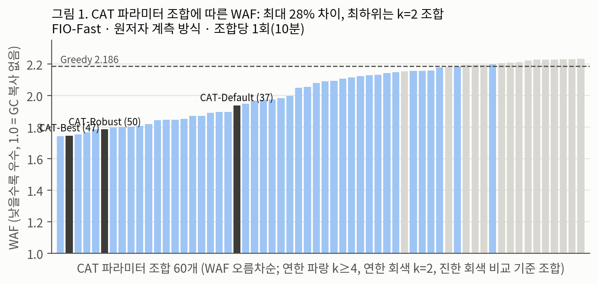
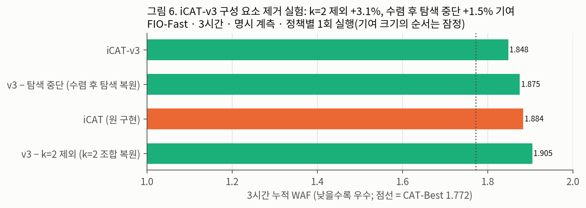
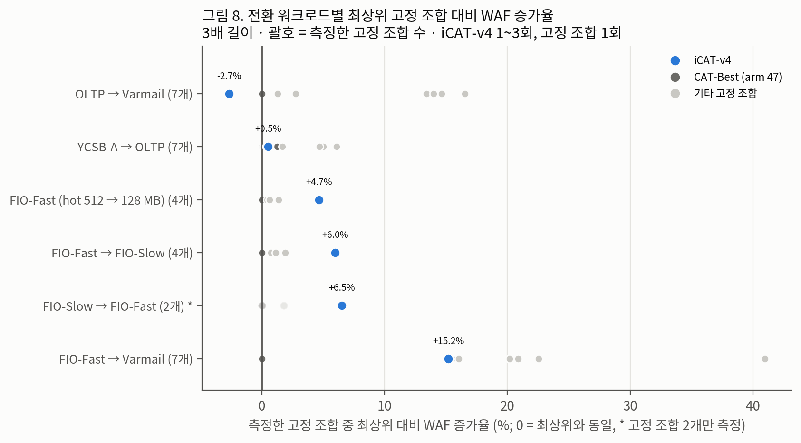
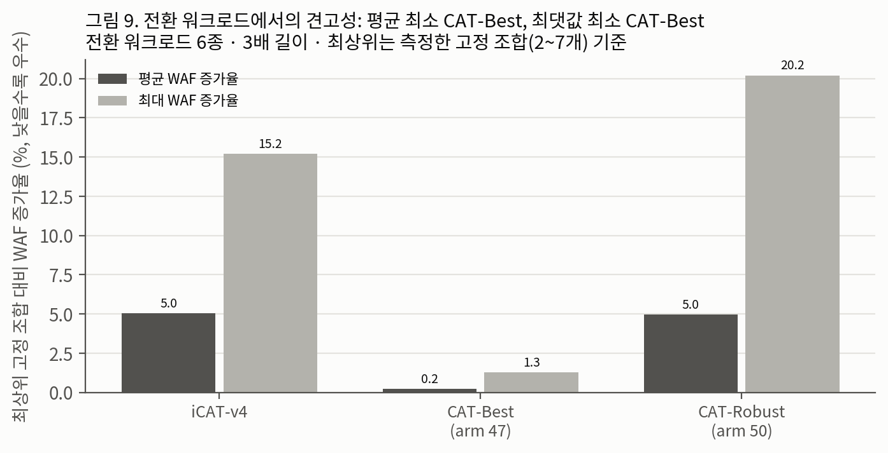

<!-- 2026-11-24 데이터 유효성 수정(고컴): report/final-e1-validation/manuscript_revision_list.md -->
<!--
논문의 실험 부분(PAPER_KCI_DRAFT.md 3·4·6·8장). v3 (리뷰 반영).
-->

# 실험

## 3. 실험 환경과 재현 검증

### 3.1 환경

NVMeVirt[8]로 8 GiB conventional SSD(FTL 파티션 4개, 오버프로비저닝 7%)를 구성하였다. 호스트는 Intel i7-7700, Linux 커널 7.0.0-31이며, 가상 SSD에 ext4를 nodiscard 옵션으로 마운트하였다. 원 저장소 소스는 대용량 연속 메모리 할당 두 곳만 kvmalloc/kvzalloc로 변경하였고 정책 코드는 수정하지 않았다.

WAF는 두 방식으로 측정하였다. **워밍업 제외 계측**(원 저장소 방식)은 파티션마다 처음 100회의 GC를 제외하고 모듈 해제 시점까지 집계한다. **구간 지정 계측**은 6 GiB 순차 쓰기와 3 GiB 무작위 쓰기로 장치를 사전 조건화한 뒤, 명시적인 시작·종료 신호 사이를 집계하며, 매 실행마다 FTL이 집계한 호스트 쓰기량이 블록 계층 통계와 일치하는지 검사한다. 동일 조합에서 두 방식은 1.5~3% 차이를 보였으므로(예: arm 47에서 1.746 대 1.774), **모든 비교는 동일 계측 방식의 값 사이에서만 수행하였다.** 60개 조합 전수 측정(3.3절)은 워밍업 제외 계측, 학습기와의 비교(6장)는 구간 지정 계측을 사용하였다.

### 3.2 워크로드

모든 fio 워크로드는 ext4 위의 6 GiB 파일(사용자 용량의 약 80%)에 direct I/O, libaio, 큐 깊이 32로 4 KB 무작위 쓰기를 수행한다. **핫 영역 갱신 주기**는 영역의 페이지 수를 그 영역의 초당 쓰기 수로 나눈 값이다.

**표 2.** 단일 워크로드

| 이름 | 구성 | 핫 영역 갱신 주기 |
|---|---|---|
| FIO-Fast | 512 MB / 1.5 GB / 4 GB 세 영역에 동시에 초당 24K / 12K / 4K회 쓰기. 기본 길이 10분 | 5.5초 |
| FIO-Slow | FIO-Fast와 같은 배치, 초당 쓰기 1/4, 같은 시간 | 22초 |
| FIO-Slow16 | 초당 쓰기 1/16, 20분 | 87초 |
| FIO-HotCold | 1 GB(초당 8K) + 5 GB(초당 2K) 두 영역, 10분 | 33초 |
| FIO-Shift | 앞 2 GB를 초당 32K·뒤 4 GB를 8K로 5분, 이후 두 영역의 속도를 맞바꾸어 5분 | 16초 |
| YCSB-A / YCSB-B | YCSB[10] + SQLite(WAL, 페이지 4 KB, synchronous=NORMAL), zipfian, 읽기:갱신 50:50 / 95:5. 레코드 1 KB, 단독 실행 400만 / 500만 레코드에 1,200만 / 600만 연산 | – |
| OLTP | Filebench[11] oltp: 512 MB 파일 10개, 쓰기 프로세스 10개(2 KB 무작위 쓰기 + dsync), 읽기 프로세스 200개, 5분 | – |
| Varmail | Filebench varmail: 평균 16 KB 파일 15만 개(단독) / 2.4만 개(전환), 스레드 16개의 생성·추가 쓰기·fsync·삭제 반복, 5분 | – |

전환 워크로드는 단일 워크로드를 순서대로 이어 실행하며(표기 A → B), 앞 단계의 파일과 데이터베이스는 삭제하지 않고 유지한다. 단계 사이에 재마운트나 사전 조건화는 없다. 단계 길이는 쓰기량으로 정한다(fio는 I/O 총량, YCSB는 연산 수). Filebench 단계만 시간으로 정한다. **$m$배 길이**는 모든 단계의 쓰기량(및 Filebench 실행 시간)을 $m$배로 한 것이다. 전환 워크로드 단계의 SQLite 데이터베이스는 6 GiB 파일과 공존하도록 60만 레코드(약 0.8 GiB)로 줄였고, OLTP는 파일 크기를 32~64 MB로 줄였다.

**표 3.** 전환 워크로드 (1배 길이 기준, 단계는 "단계 1 → 단계 2"로 표기)

| 이름 | 구성 | 1배 길이 | 측정한 길이 |
|---|---|---|---|
| FIO-Fast → YCSB-A | FIO-Fast 10분 분량 → YCSB-A(적재 + 400만 연산) | 약 16분 | 1, 3, 6배 (결과 무효: YCSB 오류, 제외) |
| YCSB-A → FIO-Fast | 역순 | 약 25분 | 1, 3배 (결과 무효: YCSB 오류, 제외) |
| FIO-Slow → FIO-Fast | FIO-Slow 10분 → FIO-Fast 10분 분량 | 20분 | 1, 3, 6배 |
| FIO-Fast → FIO-Slow | 역순 | 20분 | 1, 3, 6배 |
| FIO-Fast (hot 512 → 128 MB) | FIO-Fast → 핫 영역만 128 MB로 줄인 FIO-Fast(속도 동일) | 20분 | 1, 3, 6배 |
| FIO-Fast → Varmail | FIO-Fast 10분 분량 → Varmail 5분 | 약 15분 | 1, 3배 |
| OLTP → Varmail | OLTP(파일 64 MB) 5분 → Varmail 5분 | 10분 | 1, 3배 |
| YCSB-A → OLTP | YCSB-A(25만 레코드) → OLTP(파일 32 MB) 5분 | 약 10분 | 1, 3배 |
| YCSB-A → YCSB-B | 같은 데이터베이스에서 갱신 50% → 5% | 약 10분 | 1, 3배 (결과 무효: YCSB 오류, 제외) |
| FIO-Slow → FIO-Fast → YCSB-A | 3단계 | 약 25분 | 1, 3배 (결과 무효: YCSB 오류, 제외) |
| FIO-Fast ∥ YCSB-A | FIO-Fast(쓰기량 1/2)와 YCSB-A를 동시에 실행 | 약 12분 | 1, 3배 (YCSB 출력 미기록으로 검증 불가, 제외) |
| FIO-Fast ↔ FIO-Slow (60 s × 5) | FIO-Fast 60초 분량과 FIO-Slow 60초를 5회 번갈아 실행 | 10분 | 1, 3배 |
| FIO-Fast → 유휴 → FIO-Fast | FIO-Fast 5분 분량 → I/O 없이 5분 → FIO-Fast 5분 분량 | 15분 | 1, 3배 |
| 점진적 부하 증가 | FIO-Slow 배치에서 초당 쓰기를 2분마다 10K → 50K로 증가 | 10분 | 1배 (단계 길이가 고정되어 길이 확장 불가) |
| 3단계 균등 전환 | FIO-Fast → YCSB-A → FIO-Fast, 단계별 호스트 쓰기량 동일(각 약 7,200만 페이지) | – | 3배 (약 2.3시간; 단계 2·3 결과 무효, 재측정 중) |

전환 워크로드의 1배 길이 실행은 학습기의 초기 순회(iCAT 약 30분, iCAT-v3·v4 약 15분)보다 짧거나 비슷하므로, 학습기 평가는 3배 이상 길이에서 수행하였다. 3배 길이 비교 대상은 길이 확장이 불가한 점진적 부하 증가와 별도 설계한 3단계 균등 전환을 제외한 13종이며, 이 중 YCSB 단계에서 데이터베이스 공간 부족(SQLITE_FULL)으로 연산이 실패한 5종을 제외한 8종을 결과에 사용한다(8장 한계 7).

### 3.3 재현 검증과 파라미터 민감도 (Q1)

워밍업 제외 계측으로 측정한 Greedy의 WAF는 FIO-Fast에서 3회 평균 2.186으로 원 저장소 기록(2.223)과 1.7% 차이였다. 60개 조합의 순위는 원 저장소 기록과 Spearman 상관계수 0.959(FIO-Fast), 0.979(YCSB-A)로 일치하였다. OLTP는 0.164로 낮았는데, 같은 방식(5분, 1회)으로 상위 조합 4개를 3회 반복 측정한 결과 조합 간 평균 차이(1.6% 이내)가 같은 조합의 반복 간 차이(최대 8%)보다 작았다. OLTP에서는 파라미터의 영향이 짧은 실행의 측정 편차보다 작다.

**그림 1.** FIO-Fast에서 CAT 파라미터 조합 60개의 WAF (오름차순, 워밍업 제외 계측, 조합당 1회 10분). 연한 회색은 $k=2$ 조합, 진한 회색은 표 1의 비교 기준 조합이며 점선은 Greedy(3회 평균)이다.

그림 1과 같이 WAF는 조합에 따라 1.744(arm 31)에서 2.231까지 약 28% 차이 났다. 하위권은 $k=2$ 조합이 차지하였으며, 원 저장소 기록의 워크로드 6종 모두에서 최하위 조합은 $k=2$였고 Greedy와 0.4% 이내였다. 상위 조합은 파라미터 공간에서 인접하여 분포하였다($k$ 7~10, $s$ 25~50%). 핫 영역 갱신 주기가 87초인 FIO-Slow16에서는 측정한 21개 조합 중 상위 12개가 1% 이내에 분포하여, 갱신 주기가 길어지면 최적 조합이 다른 영역으로 이동한다는 사전 가설은 기각되었다.

## 4. iCAT의 분석 (Q2, Q3)

### 4.1 결과

1배 길이(10~30분)로 단일 워크로드와 전환 워크로드를 각 3회 실행하였다. 데이터 유효성 검사를 통과한 단일 워크로드 8종과 전환 워크로드 9종(전환 5종은 YCSB 단계 오류로 제외) 중 13종에서 WAF 순서는 CAT-Best, CAT-Robust < CAT-Default < iCAT < Greedy였다(부록 표 A1). 예외는 SQLite 읽기95/수정5 단독, OLTP → Varmail, YCSB-A → OLTP에서 iCAT이 CAT-Default보다 낮았던 3종과, Varmail 단독에서 iCAT이 Greedy보다 높았던 1종이다. FIO-Fast 10분 실행에서 iCAT의 WAF(2.001)는 같은 방식으로 재측정한 상위 고정 조합 15개(6.1절) 모두와 CAT-Default(1.974)보다 높았다. 실행이 길어지면 iCAT도 개선되어, FIO-Fast 3시간 실행(1.884)에서는 CAT-Default(1.974)보다 낮아졌다. 그러나 CAT-Best와 CAT-Robust보다는 모든 길이에서 높았다.

### 4.2 원인: 측정 변동보다 탐색 비용

동일 조합을 판단 구간 단위로 반복 측정한 WAF의 범위는 0.385로, 조합 간 실제 차이(0.098)보다 컸다. 이 변동이 직전 구간에 적용된 조합의 영향인지 확인하기 위해, 같은 조합의 구간 WAF를 직전 구간이 같은 조합인 경우와 다른 조합인 경우로 나누었다. 표준편차는 각각 0.120과 0.139로, 변동의 대부분은 직전 조합과 무관한 구간 자체의 변동이었다. 판단 구간을 3배로 늘려 변동을 줄인 iCAT-v2는 FIO-Fast 3시간 실행에서 iCAT과 차이가 없었다(1.878~1.902 대 1.884).

**그림 2.** FIO-Fast 초기 3시간 동안 학습기가 적용한 조합의 분포 (구간 지정 계측, 정책별 1회 실행). 조합 등급은 그림 1의 값으로 정하며, **상위 조합**은 그림 1의 최상위(1.744) 대비 WAF 3% 이내, **저성능 조합**은 15% 초과, 그 사이를 **중위 조합**으로 한다.

**표 4.** 저성능 조합 사용 비율의 분해 (FIO-Fast, 초기 3시간)

| 정책 | 전체 | 초기 순회 중 (시간 비중) | 순회 이후 (전체 대비) |
|---|---:|---:|---:|
| iCAT | 20.9% | 55.0% (14%) | 15.4% (13.3%p) |
| iCAT-v2 | 19.7% | 55.0% (12%) | 14.9% (13.1%p) |
| iCAT-v3 | 12.3% | 40.0% (6%) | 10.5% (9.9%p) |
| iCAT-v4 | 4.0% | 40.0% (6%) | 1.7% (1.6%p) |

iCAT이 사용한 저성능 조합 20.9% 중 7.6%p는 초기 강제 순회에서, 13.3%p는 순회 이후에 발생하였다. 순회 이후의 사용은 세 요인에서 비롯된다. (1) 수렴 이후에도 8구간마다 가장 오래 적용하지 않은 조합을 적용하는데, 이러한 조합은 대부분 저성능 조합이다. (2) 할인 계수로 과거 보상이 감쇠하여 저성능 조합이 다시 탐색 대상이 된다. (3) 초기화 임계값 12.5%는 구간 변동만으로도 초과될 수 있다.

## 6. 실험 결과

모든 결과는 구간 지정 계측 값이다.

### 6.1 단일 워크로드

**표 5.** FIO-Fast에서 실행 시간별 누적 WAF (정책별 1회 실행; iCAT-v2 3시간은 2회 평균; iCAT-v4의 1·3시간 값은 10시간 실행의 해당 시점 누적값)

| 실행 시간 | CAT-Best | CAT-Robust | CAT-Default | iCAT | iCAT-v2 | iCAT-v3 | iCAT-v4 |
|---|---:|---:|---:|---:|---:|---:|---:|
| 10분 | 1.774 | – | 1.974 | 2.001 | (순회 중 종료) | 1.963 | – |
| 30분 | 1.760 | – | – | 2.002 | 2.004 | 1.939 | – |
| 1시간 | 1.773 | 1.812 | – | 1.964 | 1.958 | 1.903 | 1.871 |
| 3시간 | 1.772 | 1.814 | – | 1.884 | 1.890 | 1.848 | 1.829 |
| 10시간 | – | – | – | – | – | – | 1.807 |

고정 조합의 WAF는 실행 시간과 거의 무관하였다(arm 47: 10분 1.774, 3시간 1.772). "–"는 해당 길이로 측정하지 않은 칸이다.

**그림 4.** FIO-Fast에서 학습기의 누적 WAF를 고정 조합 대비 순위로 나타낸 변화 (정책별 1회 실행). 순위 기준은 그림 1의 상위 14개 조합과 CAT-Default를 구간 지정 계측으로 재측정한 15개이다. CAT-Default는 이 15개 중 15위이며 60개 전체에서는 약 21위이다.

모든 시점에서 iCAT-v4 < iCAT-v3 < iCAT 순이었다. 누적 WAF가 실행이 길어질수록 낮아지는 것은 초기 순회 비용이 긴 실행에 분산되기 때문이다. iCAT-v4의 구간 WAF(해당 시간 구간만의 WAF)는 3시간 이후 약 1.80에서 안정되었다. 재측정한 15개와 비교하면 iCAT-v4의 10시간 누적 WAF(1.807)는 5위로 CAT-Robust(1.812, 6위)보다 낮았으나 차이는 0.3%였다. 같은 3시간 시점에서는 iCAT-v4가 8위, iCAT-v3가 11위, iCAT이 14위였다.

**그림 5.** iCAT-v4가 판단 구간마다 적용한 조합의 순위 (FIO-Fast, 초기 3시간, 1회 실행; 순위는 그림 1 기준). 점은 판단 구간 하나, 선은 6분 구간의 중앙값이다. 약 1.5시간 이후 상위 3위 이내 조합(arm 31, 47, 46)을 주로 적용하며, 간헐적인 10위 부근 적용은 이웃 탐색이다. 순회(약 15분) 이후 1.5시간까지 20~30위 조합을 적용한 것은 후보 제거 이전의 UCB 탐색이다.

**구성 요소 제거.** iCAT-v3의 변경 중 두 가지를 하나씩 되돌린 결과(그림 6), $k=2$ 조합을 복원하면 3시간 WAF가 1.848에서 1.905로(+3.1%), 수렴 후 탐색을 복원하면 1.875로(+1.5%) 높아졌다. $k=2$만 복원한 경우가 iCAT(1.884)보다도 높은 것은, iCAT-v3의 다른 변경(1회 순회)이 $k=2$ 조합까지 포함한 상태에서는 오히려 불리할 수 있음을 시사한다. 두 효과의 합(4.6%)이 iCAT 대비 iCAT-v3의 개선(1.9%)보다 커서 요소 간 상호작용이 있다. 각 1회 실행이므로 크기는 잠정적이며, 나머지 변경(판단 구간, 순회 횟수, 초기화 임계값)과 iCAT-v4의 세 메커니즘에 대한 제거 실험을 진행 중이다【결과 대기】.

**그림 6.** iCAT-v3 구성 요소 제거 실험 (FIO-Fast, 3시간 누적 WAF, 정책별 1회 실행). 막대 이름의 "v3 − X"는 iCAT-v3에서 변경 X를 되돌린 것이다. 점선은 CAT-Best이다.

### 6.2 전환 워크로드

**CAT-Default, CAT-Robust와의 비교.** 3배 길이 전환 워크로드 중 데이터 유효성 검사를 통과한 8종에서 iCAT-v4를 CAT-Robust와 비교하였다(그림 7). iCAT-v4는 3종에서 1.1~5.3% 낮은 WAF를 보였고, 5종에서 3.2~4.9% 높았다. 우수한 3종에는 CAT-Robust가 부적합한 단계(Varmail에서 arm 50은 측정한 상위 조합보다 16% 높음)가 포함되었고, 열세인 5종은 CAT-Robust가 상위권인 fio 단계로만 구성되었다. CAT-Default를 같은 길이로 측정한 유효 3종에서는 iCAT-v4가 모두 낮았다(4.3~18.3%). **현재 iCAT-v4는 우수했던 3종만 2~3회, 나머지 5종은 1회 실행하였다.** 모든 전환 워크로드를 3회로 맞춘 결과로 그림 7을 갱신할 예정이다【결과 대기】.

**그림 7.** 3배 길이 전환 워크로드 8종(데이터 유효성 검사 통과)에서 CAT-Robust 대비 iCAT-v4의 WAF 증가율 (음수가 iCAT-v4 우수, n은 iCAT-v4 반복 횟수; CAT-Robust 1회).

**상위 고정 조합과의 비교.** iCAT-v4가 CAT-Robust보다 우수했던 3종에서 고정 조합 6개(arm 47, 46, 31, 17, 37, 50)를 같은 길이로 측정하였다(표 6).

**표 6.** 전환 워크로드 3종에서 iCAT-v4와 고정 조합 6개의 WAF (3배 길이; iCAT-v4는 2~3회 평균, 고정 조합 1회)

| 전환 워크로드 | iCAT-v4 (n) | arm 47 (Best) | arm 17 | arm 50 (Robust) | arm 46 | arm 31 | arm 37 (Default) | iCAT-v4 순위 |
|---|---:|---:|---:|---:|---:|---:|---:|---|
| OLTP → Varmail | **1.859** (3) | 1.910 | 1.935 | 1.963 | 2.167 | 2.177 | 2.226 | 1/7 |
| FIO-Fast → Varmail | 2.352 (2) | **2.042** | 2.503 | 2.454 | 2.367 | 2.468 | 2.879 | 2/7 |
| YCSB-A → OLTP | 1.127 (2) | 1.136 | **1.123** | 1.140 | 1.174 | 1.190 | 1.178 | 2/7 |

iCAT-v4는 3종 모두에서 1~2위였으며, OLTP → Varmail에서는 측정한 고정 조합 6개보다 모두 낮았다(arm 47 대비 −2.7%). 그러나 이 차이는 iCAT-v4의 반복 간 차이(약 2%)와 비슷하고 고정 조합은 1회 측정이므로, 고정 조합 반복 측정 결과가 나오기 전에는 "동등 이상"으로 해석한다【결과 대기: arm 47·17·50 각 3회】. 나머지 2종에서는 전 단계에 적합한 단일 조합(arm 47 또는 arm 17)이 존재하였고, FIO-Fast → Varmail에서 iCAT-v4는 arm 47보다 15.2% 높았다.

**그림 8.** 전환 워크로드별(데이터 유효성 검사 통과 6종), 측정한 고정 조합 중 최상위 대비 WAF 증가율 (3배 길이; 괄호는 측정한 고정 조합 수, *는 2개만 측정). 【선별 실험 결과로 갱신 예정】

**견고성.** 데이터 유효성 검사를 통과하고 iCAT-v4, CAT-Best, CAT-Robust를 모두 같은 길이로 측정한 전환 워크로드 6종에서 측정 고정 조합 중 최상위 대비 WAF 증가율의 평균은 CAT-Best 0.2%, iCAT-v4 5.0%, CAT-Robust 5.0%였고, 최댓값은 CAT-Best 1.3%(YCSB-A → OLTP), iCAT-v4 15.2%(FIO-Fast → Varmail), CAT-Robust 20.2%(FIO-Fast → Varmail)였다(그림 9). 원 저장소 워크로드로 선정된 CAT-Robust는 전환 워크로드에서 견고하지 않았다. 이 6종에서는 CAT-Best가 평균과 최댓값 모두 가장 작았으며, 기준 조합 수가 워크로드마다 2~7개로 달라 해석에 주의가 필요하다.

**그림 9.** 전환 워크로드 6종(데이터 유효성 검사 통과)에서 정책별 최상위 고정 조합 대비 WAF 증가율의 평균과 최댓값 (3배 길이).

【결과 대기 · 표 7 자리: 전환 워크로드 11종에서 고정 조합 16개를 1배 길이로 선별한 뒤 상위 3개를 3배 길이로 확인한 결과. 워크로드별 최상위 고정 조합, 전체에서 평균·최대 WAF 증가율이 가장 작은 고정 조합, iCAT-v4(n=3)의 평균·최대 WAF 증가율.】

**3단계 균등 전환.** 【사용 금지 (2026-11-24)】 FIO-Fast → YCSB-A → FIO-Fast를 단계별 호스트 쓰기량이 같도록 구성한 실험은 YCSB 단계에서 데이터베이스 공간 부족(SQLITE_FULL)으로 연산이 실패하여 단계 2·3과 전체 WAF가 무효로 판정되었다(8장 한계 7). 표 8과 그림 10은 YCSB 레코드 수를 줄인 재측정에서 정책별 유효 3회가 확보될 때까지 싣지 않는다. 단계 1(FIO-Fast)의 결과만 유효하다. 근거: `report/final-e1-validation/tables/table8_status.md`.

## 8. 한계

1. 학습기 결과의 반복 횟수가 1~3회이다. iCAT-v4의 반복 간 차이는 약 2%였다. 고정 조합의 반복 간 차이는 워밍업 제외 계측의 5분 OLTP 실행에서 최대 8%였다. 구간 지정 계측에서의 반복 간 차이는 기존 근거(3단계 균등 전환의 arm 50 반복)가 무효로 판정되어 다시 확인해야 한다.
2. iCAT-v3와 iCAT-v4는 FIO-Fast와 3단계 균등 전환의 결과를 참고하여 설계하였다(3단계 균등 전환의 측정 결과는 이후 무효로 판정되었다; 한계 7). 단일 워크로드에서 iCAT-v3·v4를 평가한 것은 FIO-Fast뿐이다.
3. 전환 워크로드의 고정 조합 비교는 일부 조합(유효 6종 기준 2~7개)에 한정된다.
4. iCAT-v4의 실행 중 제거는 고정 임계값(15%)을 사용하며, 판단 구간 변동(표준편차 약 0.12, WAF 1.8의 약 7%)을 고려하면 상위 조합이 잘못 제거될 수 있다. 잘못 제거된 빈도는 측정하지 않았다.
5. 단일 가상 SSD(8 GiB, 오버프로비저닝 7%)에서만 실험하였다. 실제 SSD, 다른 오버프로비저닝 비율, 실제 서버 트레이스는 다루지 않았다.
6. 실험 기간 중 두 차례, 메모리에 캐시된 실행 파일이 손상되어 일부 실행이 시작 직후 실패하였다. 해당 실행은 재수행하였다. 정상 종료한 실행은 호스트 쓰기량이 블록 계층 통계와 일치함을 확인하였으나, 원인(가상 SSD의 메모리 접근 또는 하드웨어 결함)은 확인하지 못하였다.
7. YCSB를 포함한 전환 워크로드 일부(FIO-Fast → YCSB-A, YCSB-A → FIO-Fast, YCSB-A → YCSB-B, FIO-Slow → FIO-Fast → YCSB-A, 3단계 균등 전환)에서는 앞 단계 파일이 남아 데이터베이스 공간이 부족해(SQLITE_FULL) YCSB 연산의 약 10% 또는 99.8%가 실패했는데도 실행이 정상 종료로 기록되었다. 원시 로그에서 이를 확인하고 해당 결과(YCSB 단계와 그 이후 단계)를 모두 제외하였다. FIO-Fast ∥ YCSB-A는 YCSB 출력이 기록되지 않아 검증할 수 없어 제외하였다. 3단계 균등 전환은 레코드 수를 줄여 재측정 중이다.

