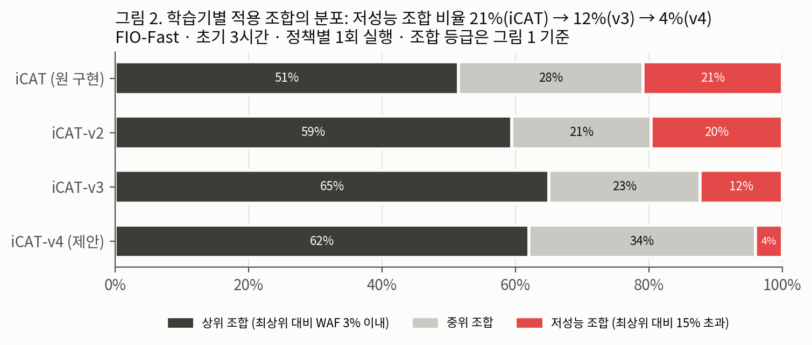
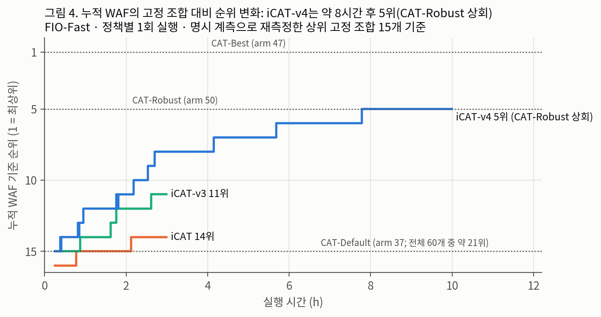
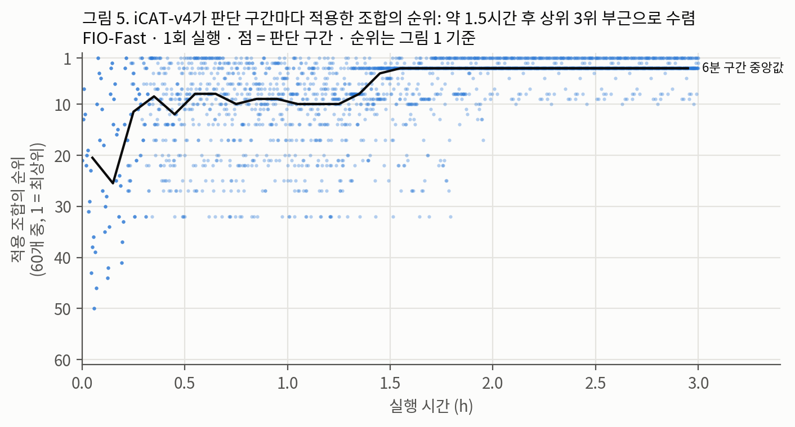
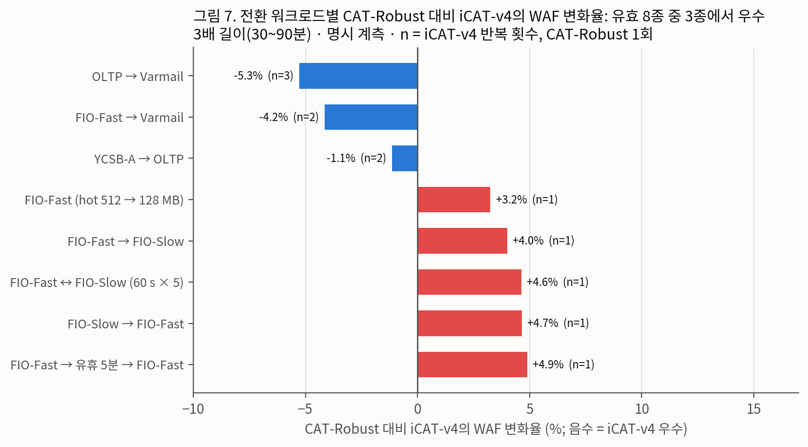

<!-- 2026-11-24 데이터 유효성 수정(고컴): report/final-e1-validation/manuscript_revision_list.md -->
<!--
논문의 실험 부분(PAPER_KCI_DRAFT.md 3·4·6·8장). v3 (리뷰 반영).
-->

# 실험

## 3. 실험 환경과 재현 검증

### 3.1 환경

NVMeVirt[8]로 8 GiB conventional SSD(FTL 파티션 4개, 오버프로비저닝 7%)를 구성하였다. 호스트는 두 대이다(Intel i7-7700, AMD Ryzen 5 3600XT). 둘 다 Linux 커널 7.0.0-31이며, 에뮬레이터 스레드에 CPU 2개를 전용으로 할당하였다. 같은 워크로드라도 호스트에 따라 처리량이 달라 쓰기량이 다르므로, 서로 다른 호스트의 결과는 합치거나 직접 비교하지 않았다. 각 표에 실행 호스트를 밝혔다. 가상 SSD에 ext4를 nodiscard 옵션으로 마운트하였다. 원 저장소 소스는 대용량 연속 메모리 할당 두 곳만 kvmalloc/kvzalloc로 변경하였고 정책 코드는 수정하지 않았다.

WAF는 두 방식으로 측정하였다. **워밍업 제외 계측**(원 저장소 방식)은 파티션마다 처음 100회의 GC를 제외하고 모듈 해제 시점까지 집계한다. **구간 지정 계측**은 6 GiB 순차 쓰기와 3 GiB 무작위 쓰기로 장치를 사전 조건화한 뒤, 명시적인 시작·종료 신호 사이를 집계하며, 매 실행마다 FTL이 집계한 호스트 쓰기량이 블록 계층 통계와 일치하는지 검사한다. 동일 조합에서 두 방식은 1.5~3% 차이를 보였으므로(예: arm 47에서 1.746 대 1.774), **모든 비교는 동일 계측 방식의 값 사이에서만 수행하였다.** 60개 조합 전수 측정(3.3절)은 워밍업 제외 계측, 학습기와의 비교(6장)는 구간 지정 계측을 사용하였다.

### 3.2 워크로드

모든 fio 워크로드는 ext4 위의 6 GiB 파일(사용자 용량의 약 80%)에 direct I/O, libaio, 큐 깊이 32로 4 KB 무작위 쓰기를 수행한다. **핫 영역 갱신 주기**는 영역의 페이지 수를 그 영역의 초당 쓰기 수로 나눈 값이다.

**표 2.** 단일 워크로드

| 이름 | 구성 | 핫 영역 갱신 주기 |
|---|---|---|
| FIO-Fast | 512 MB / 1.5 GB / 4 GB 세 영역에 동시에 초당 24K / 12K / 4K회 쓰기. 기본 길이 10분 | 5.5초 |
| FIO-Slow | FIO-Fast와 같은 배치, 초당 쓰기 1/4, 같은 시간 | 22초 |
| FIO-Slow16 | 초당 쓰기 1/16, 20분 | 87초 |
| FIO-HotCold | 1 GB(초당 8K) + 5 GB(초당 2K) 두 영역, 10분 | 33초 |
| FIO-Shift | 앞 2 GB를 초당 32K·뒤 4 GB를 8K로 5분, 이후 두 영역의 속도를 맞바꾸어 5분 | 16초 |
| YCSB-A / YCSB-B | YCSB[10] + SQLite(WAL, 페이지 4 KB, synchronous=NORMAL), zipfian, 읽기:갱신 50:50 / 95:5. 레코드 1 KB, 단독 실행 400만 / 500만 레코드에 1,200만 / 600만 연산 | – |
| OLTP | Filebench[11] oltp: 512 MB 파일 10개, 쓰기 프로세스 10개(2 KB 무작위 쓰기 + dsync), 읽기 프로세스 200개, 5분 | – |
| Varmail | Filebench varmail: 평균 16 KB 파일 15만 개(단독) / 2.4만 개(전환), 스레드 16개의 생성·추가 쓰기·fsync·삭제 반복, 5분 | – |

전환 워크로드는 단일 워크로드를 순서대로 이어 실행하며(표기 A → B), 앞 단계의 파일과 데이터베이스는 삭제하지 않고 유지한다. 단계 사이에 재마운트나 사전 조건화는 없다. 단계 길이는 쓰기량으로 정한다(fio는 I/O 총량, YCSB는 연산 수). Filebench 단계만 시간으로 정한다. **$m$배 길이**는 모든 단계의 쓰기량(및 Filebench 실행 시간)을 $m$배로 한 것이다. 전환 워크로드 단계의 SQLite 데이터베이스는 6 GiB 파일과 공존하도록 60만 레코드(약 0.8 GiB)로 줄였고, OLTP는 파일 크기를 32~64 MB로 줄였다.

**표 3.** 전환 워크로드 (1배 길이 기준, 단계는 "단계 1 → 단계 2"로 표기)

| 이름 | 구성 | 1배 길이 | 측정한 길이 |
|---|---|---|---|
| FIO-Fast → YCSB-A | FIO-Fast 10분 분량 → YCSB-A(적재 + 400만 연산) | 약 16분 | 1, 3, 6배 (결과 무효: YCSB 오류, 제외) |
| YCSB-A → FIO-Fast | 역순 | 약 25분 | 1, 3배 (결과 무효: YCSB 오류, 제외) |
| FIO-Slow → FIO-Fast | FIO-Slow 10분 → FIO-Fast 10분 분량 | 20분 | 1, 3, 6배 |
| FIO-Fast → FIO-Slow | 역순 | 20분 | 1, 3, 6배 |
| FIO-Fast (hot 512 → 128 MB) | FIO-Fast → 핫 영역만 128 MB로 줄인 FIO-Fast(속도 동일) | 20분 | 1, 3, 6배 |
| FIO-Fast → Varmail | FIO-Fast 10분 분량 → Varmail 5분 | 약 15분 | 1, 3배 |
| OLTP → Varmail | OLTP(파일 64 MB) 5분 → Varmail 5분 | 10분 | 1, 3배 |
| YCSB-A → OLTP | YCSB-A(25만 레코드) → OLTP(파일 32 MB) 5분 | 약 10분 | 1, 3배 |
| YCSB-A → YCSB-B | 같은 데이터베이스에서 갱신 50% → 5% | 약 10분 | 1, 3배 (결과 무효: YCSB 오류, 제외) |
| FIO-Slow → FIO-Fast → YCSB-A | 3단계 | 약 25분 | 1, 3배 (결과 무효: YCSB 오류, 제외) |
| FIO-Fast ∥ YCSB-A | FIO-Fast(쓰기량 1/2)와 YCSB-A를 동시에 실행 | 약 12분 | 1, 3배 (YCSB 출력 미기록으로 검증 불가, 제외) |
| FIO-Fast ↔ FIO-Slow (60 s × 5) | FIO-Fast 60초 분량과 FIO-Slow 60초를 5회 번갈아 실행 | 10분 | 1, 3배 |
| FIO-Fast → 유휴 → FIO-Fast | FIO-Fast 5분 분량 → I/O 없이 5분 → FIO-Fast 5분 분량 | 15분 | 1, 3배 |
| 점진적 부하 증가 | FIO-Slow 배치에서 초당 쓰기를 2분마다 10K → 50K로 증가 | 10분 | 1배 (단계 길이가 고정되어 길이 확장 불가) |
| 3단계 균등 전환 | FIO-Fast → YCSB-A → FIO-Fast, 단계별 호스트 쓰기량 동일(각 약 7,200만 페이지) | – | 3배 (약 2.3시간; 단계 2·3 결과 무효, 재측정 중) |

전환 워크로드의 1배 길이 실행은 학습기의 초기 순회(iCAT 약 30분, iCAT-v3·v4 약 15분)보다 짧거나 비슷하므로, 학습기 평가는 3배 이상 길이에서 수행하였다. 3배 길이 비교 대상은 길이 확장이 불가한 점진적 부하 증가와 별도 설계한 3단계 균등 전환을 제외한 13종이며, 이 중 YCSB 단계에서 데이터베이스 공간 부족(SQLITE_FULL)으로 연산이 실패한 5종을 제외한 8종을 결과에 사용한다(8장 한계 7).

### 3.3 재현 검증과 파라미터 민감도 (Q1)

워밍업 제외 계측으로 측정한 Greedy의 WAF는 FIO-Fast에서 3회 평균 2.186으로 원 저장소 기록(2.223)과 1.7% 차이였다. 60개 조합의 순위는 원 저장소 기록과 Spearman 상관계수 0.959(FIO-Fast), 0.979(YCSB-A)로 일치하였다. OLTP는 0.164로 낮았는데, 같은 방식(5분, 1회)으로 상위 조합 4개를 3회 반복 측정한 결과 조합 간 평균 차이(1.6% 이내)가 같은 조합의 반복 간 차이(최대 8%)보다 작았다. OLTP에서는 파라미터의 영향이 짧은 실행의 측정 편차보다 작다.

**그림 1.** FIO-Fast에서 CAT 파라미터 조합 60개의 WAF (오름차순, 워밍업 제외 계측, 조합당 1회 10분). 연한 회색은 $k=2$ 조합, 진한 회색은 표 1의 비교 기준 조합이며 점선은 Greedy(3회 평균)이다.

그림 1과 같이 WAF는 조합에 따라 1.744(arm 31)에서 2.231까지 약 28% 차이 났다. 하위권은 $k=2$ 조합이 차지하였으며, 원 저장소 기록의 워크로드 6종 모두에서 최하위 조합은 $k=2$였고 Greedy와 0.4% 이내였다. 상위 조합은 파라미터 공간에서 인접하여 분포하였다($k$ 7~10, $s$ 25~50%). 핫 영역 갱신 주기가 87초인 FIO-Slow16에서는 측정한 21개 조합 중 상위 12개가 1% 이내에 분포하여, 갱신 주기가 길어지면 최적 조합이 다른 영역으로 이동한다는 사전 가설은 기각되었다.

## 4. iCAT의 분석 (Q2, Q3)

### 4.1 결과

1배 길이(10~30분)로 단일 워크로드와 전환 워크로드를 각 3회 실행하였다. 데이터 유효성 검사를 통과한 단일 워크로드 8종과 전환 워크로드 9종(전환 5종은 YCSB 단계 오류로 제외) 중 13종에서 WAF 순서는 CAT-Best, CAT-Robust < CAT-Default < iCAT < Greedy였다(부록 표 A1). 예외는 YCSB-B 단독(iCAT 1.104, CAT-Default 1.113, 각 3회의 범위가 겹치지 않음), OLTP → Varmail(1.946 대 2.325), YCSB-A → OLTP(1.171 대 1.231)에서 iCAT이 CAT-Default보다 낮았던 3종과, Varmail 단독에서 iCAT(4.927, 3회)이 Greedy(4.762, 1회)보다 높았던 1종이다. OLTP → Varmail에서는 단계별 방향이 달라, OLTP 단계에서는 iCAT이 높고(1.598 대 1.417) Varmail 단계에서는 낮았다(2.005 대 2.497). 예외의 원인은 확인하지 않았다. 검증하지 않은 가능한 설명으로는 (1) CAT-Default가 Varmail 계열에 특히 부적합하여(Varmail 단독에서 CAT-Best 대비 30.7% 높음) 여러 조합을 거치는 iCAT의 평균이 더 낮아졌을 가능성, (2) 5분 Varmail 실행이 iCAT의 초기 순회보다 짧아 순회 초반의 조합만 사용되었을 가능성, (3) 시간 기준 실행이어서 정책별 호스트 쓰기량이 달랐던 영향(Varmail 단독에서 정책별 1,906만~2,322만 페이지)이 있다. FIO-Fast 10분 실행에서 iCAT의 WAF(2.001)는 같은 방식으로 재측정한 상위 고정 조합 15개(6.1절) 모두와 CAT-Default(1.974)보다 높았다. 실행이 길어지면 iCAT도 개선되어, FIO-Fast 3시간 실행(1.884)에서는 CAT-Default(1.974)보다 낮아졌다. 그러나 CAT-Best와 CAT-Robust보다는 모든 길이에서 높았다.

### 4.2 원인: 측정 변동보다 탐색 비용

동일 조합을 판단 구간 단위로 반복 측정한 WAF의 범위는 0.385로, 조합 간 실제 차이(0.098)보다 컸다. 이 변동이 직전 구간에 적용된 조합의 영향인지 확인하기 위해, 같은 조합의 구간 WAF를 직전 구간이 같은 조합인 경우와 다른 조합인 경우로 나누었다. 표준편차는 각각 0.120과 0.139로, 변동의 대부분은 직전 조합과 무관한 구간 자체의 변동이었다. 판단 구간을 3배로 늘려 변동을 줄인 iCAT-v2는 FIO-Fast 3시간 실행에서 iCAT과 차이가 없었다(1.878~1.902 대 1.884).

**그림 2.** FIO-Fast 초기 3시간 동안 학습기가 적용한 조합의 분포 (구간 지정 계측, 정책별 1회 실행). 조합 등급은 그림 1의 값으로 정하며, **상위 조합**은 그림 1의 최상위(1.744) 대비 WAF 3% 이내, **저성능 조합**은 15% 초과, 그 사이를 **중위 조합**으로 한다.

**표 4.** 저성능 조합 사용 비율의 분해 (FIO-Fast, 초기 3시간)

| 정책 | 전체 | 초기 순회 중 (시간 비중) | 순회 이후 (전체 대비) |
|---|---:|---:|---:|
| iCAT | 20.9% | 55.0% (14%) | 15.4% (13.3%p) |
| iCAT-v2 | 19.7% | 55.0% (12%) | 14.9% (13.1%p) |
| iCAT-v3 | 12.3% | 40.0% (6%) | 10.5% (9.9%p) |
| iCAT-v4 | 4.0% | 40.0% (6%) | 1.7% (1.6%p) |

iCAT이 사용한 저성능 조합 20.9% 중 7.6%p는 초기 강제 순회에서, 13.3%p는 순회 이후에 발생하였다. 순회 이후의 사용은 세 요인에서 비롯된다. (1) 수렴 이후에도 8구간마다 가장 오래 적용하지 않은 조합을 적용하는데, 이러한 조합은 대부분 저성능 조합이다. (2) 할인 계수로 과거 보상이 감쇠하여 저성능 조합이 다시 탐색 대상이 된다. (3) 초기화 임계값 12.5%는 구간 변동만으로도 초과될 수 있다.

## 6. 실험 결과

모든 결과는 구간 지정 계측 값이다.

### 6.1 단일 워크로드

**표 5.** FIO-Fast에서 실행 시간별 누적 WAF (정책별 1회 실행; iCAT-v2 3시간은 2회 평균; iCAT-v4의 1·3시간 값은 10시간 실행의 해당 시점 누적값)

| 실행 시간 | CAT-Best | CAT-Robust | CAT-Default | iCAT | iCAT-v2 | iCAT-v3 | iCAT-v4 |
|---|---:|---:|---:|---:|---:|---:|---:|
| 10분 | 1.774 | – | 1.974 | 2.001 | (순회 중 종료) | 1.963 | – |
| 30분 | 1.760 | – | – | 2.002 | 2.004 | 1.939 | – |
| 1시간 | 1.773 | 1.812 | – | 1.964 | 1.958 | 1.903 | 1.871 |
| 3시간 | 1.772 | 1.814 | – | 1.884 | 1.890 | 1.848 | 1.829 |
| 10시간 | – | – | – | – | – | – | 1.807 |

고정 조합의 WAF는 실행 시간과 거의 무관하였다(arm 47: 10분 1.774, 3시간 1.772). "–"는 해당 길이로 측정하지 않은 칸이다.

**그림 4.** FIO-Fast에서 학습기의 누적 WAF를 고정 조합 대비 순위로 나타낸 변화 (정책별 1회 실행). 순위 기준은 그림 1의 상위 14개 조합과 CAT-Default를 구간 지정 계측으로 재측정한 15개이다. CAT-Default는 이 15개 중 15위이며 60개 전체에서는 약 21위이다.

모든 시점에서 iCAT-v4 < iCAT-v3 < iCAT 순이었다. 누적 WAF가 실행이 길어질수록 낮아지는 것은 초기 순회 비용이 긴 실행에 분산되기 때문이다. iCAT-v4의 구간 WAF(해당 시간 구간만의 WAF)는 3시간 이후 약 1.80에서 안정되었다. 재측정한 15개와 비교하면 iCAT-v4의 10시간 누적 WAF(1.807)는 5위로 CAT-Robust(1.812, 6위)보다 낮았으나 차이는 0.3%였다. 같은 3시간 시점에서는 iCAT-v4가 8위, iCAT-v3가 11위, iCAT이 14위였다.

**그림 5.** iCAT-v4가 판단 구간마다 적용한 조합의 순위 (FIO-Fast, 초기 3시간, 1회 실행; 순위는 그림 1 기준). 점은 판단 구간 하나, 선은 6분 구간의 중앙값이다. 약 1.5시간 이후 상위 3위 이내 조합(arm 31, 47, 46)을 주로 적용하며, 간헐적인 10위 부근 적용은 이웃 탐색이다. 순회(약 15분) 이후 1.5시간까지 20~30위 조합을 적용한 것은 후보 제거 이전의 UCB 탐색이다.

**구성 요소 제거.** iCAT-v3의 변경 중 두 가지를 하나씩 되돌린 결과(그림 6), $k=2$ 조합을 복원하면 3시간 WAF가 1.848에서 1.905로(+3.1%), 수렴 후 탐색을 복원하면 1.875로(+1.5%) 높아졌다. $k=2$만 복원한 경우가 iCAT(1.884)보다도 높은 것은, iCAT-v3의 다른 변경(1회 순회)이 $k=2$ 조합까지 포함한 상태에서는 오히려 불리할 수 있음을 시사한다. 두 효과의 합(4.6%)이 iCAT 대비 iCAT-v3의 개선(1.9%)보다 커서 요소 간 상호작용이 있다. 각 1회 실행이므로 크기는 잠정적이며, 나머지 변경(판단 구간, 순회 횟수, 초기화 임계값)과 iCAT-v4의 세 메커니즘에 대한 제거 실험을 진행 중이다【결과 대기】.

**그림 6.** iCAT-v3 구성 요소 제거 실험 (FIO-Fast, 3시간 누적 WAF, 정책별 1회 실행). 막대 이름의 "v3 − X"는 iCAT-v3에서 변경 X를 되돌린 것이다. 점선은 CAT-Best이다.

### 6.2 전환 워크로드

**CAT-Default, CAT-Robust와의 비교.** 3배 길이 전환 워크로드 중 데이터 유효성 검사를 통과한 8종에서 iCAT-v4를 CAT-Robust와 비교하였다(그림 7). iCAT-v4는 3종에서 1.1~5.3% 낮은 WAF를 보였고, 5종에서 3.2~4.9% 높았다. 우수한 3종에는 CAT-Robust가 부적합한 단계(Varmail에서 arm 50은 측정한 상위 조합보다 16% 높음)가 포함되었고, 열세인 5종은 CAT-Robust가 상위권인 fio 단계로만 구성되었다. CAT-Default를 같은 길이로 측정한 유효 3종에서는 iCAT-v4가 모두 낮았다(4.3~18.3%). **현재 iCAT-v4는 우수했던 3종만 2~3회, 나머지 5종은 1회 실행하였다.** 모든 전환 워크로드를 3회로 맞춘 결과로 그림 7을 갱신할 예정이다【결과 대기】.

**그림 7.** 3배 길이 전환 워크로드 8종(데이터 유효성 검사 통과)에서 CAT-Robust 대비 iCAT-v4의 WAF 증가율 (음수가 iCAT-v4 우수, n은 iCAT-v4 반복 횟수; CAT-Robust 1회).

**상위 고정 조합과의 비교.** iCAT-v4가 CAT-Robust보다 우수했던 3종에서 고정 조합 6개(arm 47, 46, 31, 17, 37, 50)를 같은 길이로 측정하였다(표 6).

**표 6.** 전환 워크로드 3종에서 iCAT-v4와 고정 조합 6개의 WAF (3배 길이; iCAT-v4는 2~3회 평균, 고정 조합 1회)

| 전환 워크로드 | iCAT-v4 (n) | arm 47 (Best) | arm 17 | arm 50 (Robust) | arm 46 | arm 31 | arm 37 (Default) | iCAT-v4 순위 |
|---|---:|---:|---:|---:|---:|---:|---:|---|
| OLTP → Varmail | **1.859** (3) | 1.910 | 1.935 | 1.963 | 2.167 | 2.177 | 2.226 | 1/7 |
| FIO-Fast → Varmail | 2.352 (2) | **2.042** | 2.503 | 2.454 | 2.367 | 2.468 | 2.879 | 2/7 |
| YCSB-A → OLTP | 1.127 (2) | 1.136 | **1.123** | 1.140 | 1.174 | 1.190 | 1.178 | 2/7 |

iCAT-v4는 3종 모두에서 1~2위였으며, OLTP → Varmail에서는 측정한 고정 조합 6개보다 모두 낮았다(arm 47 대비 −2.7%). 그러나 이 차이는 iCAT-v4의 반복 간 차이(약 2%)와 비슷하고 고정 조합은 1회 측정이므로, 고정 조합 반복 측정 결과가 나오기 전에는 "동등 이상"으로 해석한다【결과 대기: arm 47·17·50 각 3회】. 나머지 2종에서는 전 단계에 적합한 단일 조합(arm 47 또는 arm 17)이 존재하였고, FIO-Fast → Varmail에서 iCAT-v4는 arm 47보다 15.2% 높았다.

**그림 8.** 전환 워크로드별(데이터 유효성 검사 통과 6종), 측정한 고정 조합 중 최상위 대비 WAF 증가율 (3배 길이; 괄호는 측정한 고정 조합 수, *는 2개만 측정). 【선별 실험 결과로 갱신 예정】

**견고성.** 데이터 유효성 검사를 통과하고 iCAT-v4, CAT-Best, CAT-Robust를 모두 같은 길이로 측정한 전환 워크로드 6종에서 측정 고정 조합 중 최상위 대비 WAF 증가율의 평균은 CAT-Best 0.2%, iCAT-v4 5.0%, CAT-Robust 5.0%였고, 최댓값은 CAT-Best 1.3%(YCSB-A → OLTP), iCAT-v4 15.2%(FIO-Fast → Varmail), CAT-Robust 20.2%(FIO-Fast → Varmail)였다(그림 9). 원 저장소 워크로드로 선정된 CAT-Robust는 전환 워크로드에서 견고하지 않았다. 이 6종에서는 CAT-Best가 평균과 최댓값 모두 가장 작았으며, 기준 조합 수가 워크로드마다 2~7개로 달라 해석에 주의가 필요하다.

**그림 9.** 전환 워크로드 6종(데이터 유효성 검사 통과)에서 정책별 최상위 고정 조합 대비 WAF 증가율의 평균과 최댓값 (3배 길이).

고정 조합 16개를 1배 길이로 선별하고 상위 조합을 3배 길이로 확인한 결과는 표 7과 같다.

**표 7.** 전환 워크로드 7종에서 고정 조합 16개의 1배 길이 선별과 3배 길이 확인 (1배 값은 유효 반복 1~3회 평균, 3배 고정 조합은 1회, iCAT-v4는 1~3회; † 3배 확인 없음)

| 전환 워크로드 | 1배 선별 상위 3 (16개 중) | arm 47 / 50 / 37의 1배 순위 | 3배 확인 (측정 조합 수: 최상위) | iCAT-v4 3배 (n) |
|---|---|---|---|---|
| FIO-Fast → FIO-Slow | arm 47 1.777, arm 46 1.790, arm 32 1.797 | 1 / 5 / 15 | 4개: arm 47 1.769 | 1.874 (1), 측정 최상위 대비 +6.0% |
| FIO-Fast → Varmail | arm 47 2.377, arm 32 2.459, arm 46 2.534 | 1 / 4 / 15 | 7개: arm 47 2.042 | 2.352 (2), 측정 최상위 대비 +15.2% |
| FIO-Fast (hot 512 → 128 MB) | arm 47 1.777, arm 31 1.785, arm 46 1.786 | 1 / 6 / 15 | 4개: arm 47 1.776 | 1.859 (1), 측정 최상위 대비 +4.7% |
| FIO-Fast ↔ FIO-Slow (60 s × 5) | arm 47 1.543, arm 32 1.548, arm 46 1.569 | 1 / 4 / 15 | † 3배 확인 없음 (arm 50만 측정) | 1.768 (1) |
| OLTP → Varmail | arm 47 1.851, arm 17 1.929, arm 16 1.961 | 1 / 6 / 15 | 7개: arm 47 1.910 | 1.859 (3), 측정 최상위 대비 −2.7% |
| YCSB-A → OLTP | arm 32 1.155, arm 50 1.157, arm 17 1.159 | 5 / 2 / 13 | 7개: arm 32 1.122 | 1.127 (2), 측정 최상위 대비 +0.5% |
| FIO-Fast → 유휴 → FIO-Fast | arm 47 1.736, arm 46 1.749, arm 32 1.759 | 1 / 5 / 15 | † 3배 확인 없음 (arm 50만 측정) | 1.906 (1) |

제외 (YCSB 오류 또는 검증 불가): YCSB-A → FIO-Fast (0/16 유효), FIO-Fast ∥ YCSB-A (0/16 유효), FIO-Slow → FIO-Fast → YCSB-A (0/16 유효), YCSB-A → YCSB-B (0/16 유효).

**유효 7종 전체에서 1배 손실(워크로드별 16개 중 최상위 대비 WAF 증가율)의 평균이 작은 순:**

| 고정 조합 | 평균 손실 (%) | 최대 손실 (%) |
|---|---:|---:|
| arm 47 | 0.2 | 1.1 |
| arm 32 | 2.0 | 7.3 |
| arm 50 | 3.4 | 8.6 |
| arm 17 | 4.6 | 9.9 |
| arm 46 | 4.7 | 17.8 |
| arm 31 | 5.4 | 17.7 |

최대 손실이 가장 작은 조합: arm 47 (1.1%).

**3단계 균등 전환.** 단계별 최상위 조합이 다른 워크로드에서 iCAT-v4의 변화 감지와 재탐색 범위의 효과를 보기 위해, FIO-Fast → YCSB-A → FIO-Fast를 단계별 호스트 쓰기량이 같도록 구성하였다. 이전 측정(YCSB-A 60만 레코드)은 YCSB 단계에서 데이터베이스 공간 부족(SQLITE_FULL)으로 연산이 실패하여 단계 2·3과 전체 WAF가 무효로 판정되었으므로 사용하지 않는다(8장 한계 7). 재측정은 YCSB-A를 30만 레코드로 줄이고 iCAT-v4, 변화 감지를 끈 변형(NoDrift), 재설정 시 45개 전체를 복원하는 변형(FullReset)을 각 3회 실행한다. 고정 조합과 이전 학습기는 재측정에 포함되지 않으므로, 이 실험으로는 iCAT-v4의 두 구성 요소의 효과만 비교한다(표 8, 그림 10).

**표 8.** 3단계 균등 전환(YCSB-A 30만 레코드, 3배 길이)에서 iCAT-v4 변형의 단계별 WAF (평균 ± 표준편차 [95% CI], 각 3회) 【재측정 결과 대기: 정책별 유효 3회 확보 전에는 수치를 싣지 않는다. 생성: `analysis/final_e1/table8_e1.py`】

| 정책 | n | 단계 1 FIO-Fast | 단계 2 YCSB-A | 단계 3 FIO-Fast | 전체 | 단계 3 재설정 (횟수, 시점) |
|---|---:|---|---|---|---|---|
| iCAT-v4 | 대기 | 대기 | 대기 | 대기 | 대기 | 대기 |
| NoDrift (변화 감지 제거) | 대기 | 대기 | 대기 | 대기 | 대기 | 대기 |
| FullReset (재설정 시 45개 복원) | 대기 | 대기 | 대기 | 대기 | 대기 | 대기 |

**그림 10.** 3단계 균등 전환(재측정)의 (a) 단계별 WAF와 95% CI, (b) 단계 3의 5분 구간 WAF. 【재측정 결과 대기】

### 6.3 기존 학습 기반 GC와의 비교: SmartGC

블록 단위 Q-learning으로 희생 블록을 고르는 SmartGC[12]와 비교하였다. 원저자 코드는 공개되어 있지 않아 논문 본문만으로 재구현하였다. 원 논문은 블록마다 20 KB Q-table을 둔다고 기술하였으나, 이를 그대로 따르면 본 장치(line 32,768개)에서 약 640 MiB가 필요하다. 그래서 재구현에서는 파티션당 Q-table 하나(상태 10,000 × 행동 2)를 사용하였다. 원 논문은 행동 선택을 두 가지로 해석할 수 있어 둘 다 구현하였다. 하나는 식 8에 따른 블록별 선택(SmartGC-EQ8)이고, 다른 하나는 Q값 순위로 만든 희생 목록이다. 결과를 보기 전에 정한 규칙에 따라 NAND 쓰기 기준 WAF가 낮은 SmartGC-EQ8을 대표로 사용하였다. 네 정책 모두 같은 호스트에서 같은 달에 20단계(FIO-Fast, FIO-Slow, Varmail) 10시간 전환 워크로드로 **정책당 1회** 실행하였다. SmartGC는 일부 쓰기를 DRAM 버퍼에 흡수하므로 WAF는 NAND 쓰기 수 기준(WAF_nand)으로 비교하였다.

**표 9.** SmartGC와의 비교 (20단계 10시간 전환, 정책당 1회 실행; 메모리는 4개 파티션 합의 계산값)

| 정책 | WAF_nand | 10시간 호스트 쓰기 | FIO 목표 IOPS 미달 job (42개 중) | Varmail 처리량 (6단계 평균) | 학습 상태 메모리 |
|---|---|---|---|---|---|
| SmartGC-EQ8 | 4.49 | 6.08 TB | 3 | 54,567 ops/s | 1,951,648 B |
| SmartGC (순위 목록) | 11.02 | 4.27 TB | 13 | 27,009 ops/s | 1,951,648 B |
| CAT-47 (고정 조합) | 3.23 | 7.93 TB | 0 | 86,413 ops/s | 0 B |
| **iCAT-v4** | **3.21** | **8.41 TB** | **0** | **93,414 ops/s** | **10,112 B** |

iCAT-v4의 WAF_nand는 SmartGC-EQ8보다 28.5% 낮았고, 같은 시간에 호스트 쓰기를 38.5% 더 처리하였다. 학습 상태 메모리는 모듈 디버그 정보의 구조체 크기로 계산하였다. iCAT-v4는 4개 파티션에 10,112 B이며 장치 용량과 무관하다. 재구현 SmartGC는 1.95 MB로 약 193배이고, 이 중 후보 목록과 정렬 키(1.31 MB)는 블록 수에 비례한다. 쓰기 버퍼 비트맵 등 학습 외 상태(393,216 B)를 포함하면 약 232배이다. 커널 vmalloc 사용량 측정에서도 CAT-47 대비 차이의 방향이 계산과 같았다(SmartGC +2,010 kB, iCAT-v4 −854 kB, 1회 측정). CAT-47과 iCAT-v4의 차이(0.7%)는 1회 실행의 변동 범위일 수 있어 우열을 주장하지 않는다. CPU 사용 시간은 비교하지 않았다. SmartGC 구현에는 시간 계측이 없고, 에뮬레이터 스레드는 정책과 무관하게 CPU 하나를 약 100% 사용하는 busy-poll 구조이기 때문이다. GC 수행 시간도 모든 빌드에서 계측하지 않았다. 지연 시간은 FIO가 목표 IOPS로 고정되어 있고, 에뮬레이터 채널 모델의 포화 경고가 네 정책 모두에서 발생하여 지연이 과소 계산된 요청이 있으므로 비교 근거로 쓰지 않는다. 생성: `analysis/final_revision/m1_smartgc.py`, 근거: `report/final-revision/M1_smartgc_comparison.md`.

### 6.4 구성 요소, 파라미터, 적응 과정의 통계 검증

FIO-Fast(30분) → YCSB-A(SQLite 25만 레코드, 30분) → FIO-Fast(30분) 전환 워크로드에서 iCAT-v4의 구성 요소와 파라미터를 바꾼 변형을 비교하였다. 모든 비교는 같은 호스트에서 연속으로 실행한 같은 배치 안에서만 수행하였다. 배치마다 iCAT-v4 대조군을 새로 3회 실행하였고, 실행 순서는 반복 블록마다 무작위로 섞었다. 같은 반복 번호는 같은 FIO·학습기 seed를 사용한다. 배치 사이에서도 같은 정책의 WAF가 0.5~1% 움직였으므로, 배치나 호스트를 넘는 차이로는 판정하지 않았다. 각 정책은 3회 실행하였다. 판정에는 iCAT-v4와의 Welch 95% 신뢰구간을 사용하였고, 구간이 0을 포함하지 않으면 "차이 있음", 포함하면 "구분되지 않음"으로 판정하였다. "구분되지 않음"은 동등하다는 뜻이 아니다. 44회 실행 모두 YCSB 연산 실패 0건, 커널 오류 0건이었고, 원시 카운터로 두 경로에서 다시 계산한 WAF가 일치하였다.

**표 10.** 전환 워크로드(FIO-Fast → YCSB-A → FIO-Fast)에서 같은 배치의 iCAT-v4 대비 WAF 차이 (각 3회; Δ = 변형 − iCAT-v4, [Welch 95% CI]; A·C·E는 같은 호스트(Ryzen 5 3600XT)의 서로 다른 배치, D·D′는 다른 호스트(i7-7700); D′의 대조군은 D의 iCAT-v4)

| 배치 | 변형 | 바꾼 것 | 전체 WAF (평균 ± SD) | 전체 Δ [95% CI] | 단계 3 Δ [95% CI] | 판정 |
|---|---|---|---|---|---|---|
| A | iCAT-v4 | — | 2.128 ± 0.005 | | | |
| A | 무작위 선택 | 매 판단 구간 45개 중 무작위 | 2.324 ± 0.006 | +0.196 [+0.184, +0.208] | +0.366 [+0.340, +0.392] | 차이 있음 |
| A | 제거·정착 없음 | 실행 중 제거와 수렴 후 탐색 중단을 끔 | 2.264 ± 0.009 | +0.135 [+0.117, +0.154] | +0.249 [+0.223, +0.275] | 차이 있음 |
| A | 변화 감지 없음 | 변화 감지를 끔 | 2.207 ± 0.052 | +0.079 [−0.050, +0.207] | +0.163 [−0.100, +0.426] | 구분되지 않음 |
| C | iCAT-v4 | — | 2.120 ± 0.029 | | | |
| C | iCAT (원 구현) | 학습기 전체 | 2.395 ± 0.003 | +0.275 [+0.203, +0.347] | +0.447 [+0.296, +0.597] | 차이 있음 |
| C | 제거 임계값 10% | 15% → 10% | 2.144 ± 0.008 | +0.024 [−0.043, +0.091] | +0.060 [−0.080, +0.201] | 구분되지 않음 |
| C | 제거 임계값 25% | 15% → 25% | 2.171 ± 0.021 | +0.051 [−0.010, +0.111] | +0.071 [−0.056, +0.198] | 구분되지 않음 |
| C | 후보 60개 | $k=2$ 제외를 풀어 60개 | 2.148 ± 0.022 | +0.028 [−0.032, +0.089] | +0.001 [−0.126, +0.127] | 구분되지 않음 |
| D | iCAT-v4 | — | 2.139 ± 0.008 | | | |
| D | 변화 감지 없음 | 변화 감지를 끔 | 2.207 ± 0.045 | +0.068 [−0.040, +0.176] | +0.141 [−0.087, +0.369] | 구분되지 않음 |
| D | 전체 재설정 | 재설정 시 45개 모두 복원 | 2.198 ± 0.020 | +0.060 [+0.016, +0.103] | +0.130 [+0.052, +0.208] | 차이 있음† |
| E | 실행 중 제거만 끔 (정착·변화 감지 유지) | | 【결과 대기】 | | | |
| E | 변화 감지 임계값 12.5% | 25% → 12.5% | 【결과 대기】 | | | |
| D′ | 탐욕 선택 (Online Greedy) | 평균 WAF 최소 arm을 항상 선택 | 【결과 대기】 | | | |

† 대비 2개 × 지표 2개에 Holm 보정을 하면 p = 0.060(단계 3), 0.072(전체)로 0.05를 넘는다. 표 10의 다른 "차이 있음" 판정은 보정 후에도 유지되었다(원 구현 대비 Holm p = 0.028, 무작위 선택·제거·정착 없음 대비 p < 0.001).

무작위 선택보다 WAF가 8.4% 낮았으므로, iCAT-v4의 이득은 후보 범위를 45개로 줄인 효과만으로 설명되지 않고 선택 규칙 자체에서도 나온다. 원 구현 대비 이득(11.5%)은 단계 3에서 가장 컸다(15.6%). 원 구현은 재설정 뒤 다시 수렴하지 못하고, 단계 3 호스트 쓰기의 97%를 탐색 중인 조합으로 처리하였다. 실행 중 제거와 수렴 후 탐색 중단을 함께 끄면 WAF가 6.4% 높아졌다. 반면 제거 임계값(10~25%)과 후보 수(45개 대 60개)는 전체 WAF와 구분되지 않았다. 후보를 60개로 늘리면 첫 단계 WAF만 3.0% 높아졌다(95% CI [+2.8, +3.2]%). 이는 추가된 15개 조합을 평가하는 초기 비용이다. 60개로 실행한 3회 모두 최종 선택은 45개 범위 안의 조합이었다. 이 결과는 이 워크로드 하나에서 얻은 것이다.

**표 11.** 단계 3 진입(YCSB-A → FIO-Fast) 후 적응 과정 (각 3회 평균 ± 표준편차; 커널 로그에서 측정)

| 배치 | 정책 | 첫 변화 감지 | 복원 후보 수 | 재수렴 시간 (재설정부터) | 재탐색 판단 구간 수 | 탐색 조합이 처리한 쓰기 비중 | 단계 3 WAF |
|---|---|---|---|---|---|---|---|
| A | iCAT-v4 | 63 ± 2 s | 17 ± 2 | 361 ± 41 s | 67 ± 12 | 0.22 ± 0.04 | 2.443 |
| C | iCAT-v4 | 61 ± 2 s | 14 ± 2 | 340 ± 126 s | 63 ± 15 | 0.22 ± 0.02 | 2.424 |
| C | iCAT (원 구현) | 3회 중 2회 감지 | 0 | 재수렴 못 함 | 120 ± 104 | 0.97 ± 0.01 | 2.871 |
| D | iCAT-v4 | 62 ± 16 s | 13 ± 5 | 499 ± 360 s | 67 ± 34 | 0.27 ± 0.04 | 2.460 |
| D | 전체 재설정 | 48 ± 31 s | 147 ± 25 | 1,182 ± 50 s | 215 ± 39 | 0.56 ± 0.06 | 2.590 |

iCAT-v4는 세 배치 모두에서 단계 전환 후 약 1분 안에 변화를 감지하였다. 감지 후에는 변화가 생긴 파티션에서 제거된 후보만 복원하였고(13~17개), 340~500초 안에 다시 수렴하였다. 45개를 모두 복원하는 전체 재설정과 비교하면 재탐색 구간은 3.2배, 탐색 조합이 처리한 쓰기 비중은 2.1배였고, 단계 3 WAF는 0.130 높았다. 그러나 변화 감지 자체를 끈 변형과는 두 배치 모두 WAF가 구분되지 않았다(표 10). 변화 감지를 끈 변형은 3회 사이 편차가 컸다(표준편차 0.045~0.052). 따라서 이 워크로드에서 변화 감지는 의도대로 동작하였으나, WAF 이득은 3회 반복으로 확인되지 않았다. 판단 구간 크기, UCB 계수, 수렴 판정 조건, 할인 계수의 값별 민감도는 측정하지 않았다(8장 한계 4). 생성: `analysis/final_revision/{revC_final.py, m6_adapt.py, m6_summary.py}`, `analysis/online_greedy/og_audit.py`. 근거: `report/final-revision/{M4_statistics_final.md, M6_adaptation_parameters.md, revC_E2_E6_E7_final.md}`.

## 8. 한계

1. 학습기 결과의 반복 횟수가 1~3회이다. iCAT-v4의 반복 간 차이는 약 2%였다. 고정 조합의 반복 간 차이는 워밍업 제외 계측의 5분 OLTP 실행에서 최대 8%였다. 구간 지정 계측에서의 반복 간 차이는 기존 근거(3단계 균등 전환의 arm 50 반복)가 무효로 판정되어 다시 확인해야 한다.
2. iCAT-v3와 iCAT-v4는 FIO-Fast와 3단계 균등 전환의 결과를 참고하여 설계하였다(3단계 균등 전환의 측정 결과는 이후 무효로 판정되었다; 한계 7). 단일 워크로드에서 iCAT-v3·v4를 평가한 것은 FIO-Fast뿐이다.
3. 전환 워크로드의 고정 조합 비교는 일부 조합(유효 6종 기준 2~7개)에 한정된다.
4. iCAT-v4의 실행 중 제거는 고정 임계값(15%)을 사용하며, 판단 구간 변동(표준편차 약 0.12, WAF 1.8의 약 7%)을 고려하면 상위 조합이 잘못 제거될 수 있다. 잘못 제거된 빈도는 측정하지 않았다. 제거 임계값 10%와 25%는 15%와 전체 WAF가 구분되지 않았으나(6.4절), 판단 구간 크기(512 MiB, GC 128회), UCB 계수(0.25), 수렴 판정 조건(12구간, 3회 확인, 0.5%), 할인 계수의 값별 민감도는 측정하지 않은 경험적 설정이다.
5. 모든 결과는 하나의 에뮬레이터 구성에서 얻었다. 구성은 NVMeVirt conventional FTL, MLC 지연 모델, 8 GiB, 오버프로비저닝 7%, FTL 파티션 4개, erase 지연 0이다. 실제 SSD, TLC/QLC 지연, 다른 용량과 오버프로비저닝 비율, 10시간을 넘는 운용, discard 사용 환경, 실제 서버 트레이스는 다루지 않았다. erase 지연이 0이므로 GC 비용은 쓰기 증폭에만 반영되고 지연에는 거의 반영되지 않는다. 따라서 지연과 처리량 결과는 실제 SSD로 옮길 수 없다. 판단 구간(GC 128회, 호스트 쓰기 512 MiB)은 고정 크기이므로 용량이 커지면 수렴 시간이 달라질 수 있다. 할인 계수의 반감기(약 1,376구간)는 90분 실험 길이보다 길어, 실험 범위 안에서는 할인이 거의 작동하지 않았다. 통계 비교는 같은 호스트·같은 배치 안에서 정책당 3회 반복으로만 수행하였다.
6. 실험 기간 중 두 차례, 메모리에 캐시된 실행 파일이 손상되어 일부 실행이 시작 직후 실패하였다. 해당 실행은 재수행하였다. 정상 종료한 실행은 호스트 쓰기량이 블록 계층 통계와 일치함을 확인하였으나, 원인(가상 SSD의 메모리 접근 또는 하드웨어 결함)은 확인하지 못하였다.
7. YCSB를 포함한 전환 워크로드 일부(FIO-Fast → YCSB-A, YCSB-A → FIO-Fast, YCSB-A → YCSB-B, FIO-Slow → FIO-Fast → YCSB-A, 3단계 균등 전환)에서는 앞 단계 파일이 남아 데이터베이스 공간이 부족해(SQLITE_FULL) YCSB 연산의 약 10% 또는 99.8%가 실패했는데도 실행이 정상 종료로 기록되었다. 원시 로그에서 이를 확인하고 해당 결과(YCSB 단계와 그 이후 단계)를 모두 제외하였다. FIO-Fast ∥ YCSB-A는 YCSB 출력이 기록되지 않아 검증할 수 없어 제외하였다. 3단계 균등 전환은 레코드 수를 줄여 재측정 중이다.

