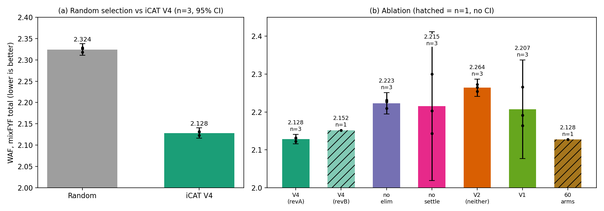
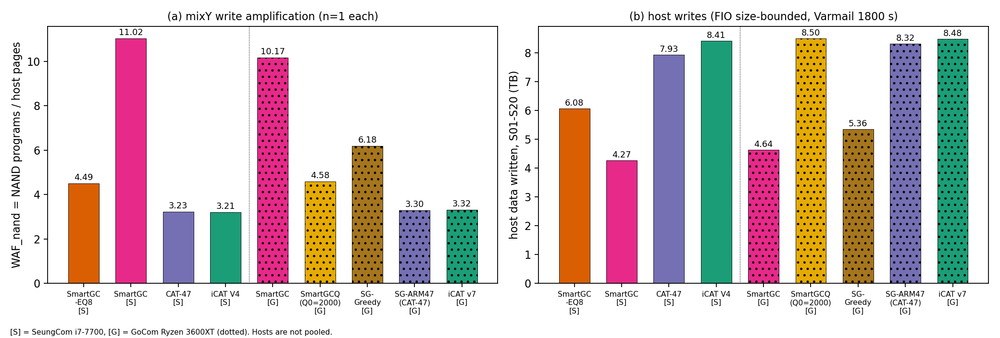
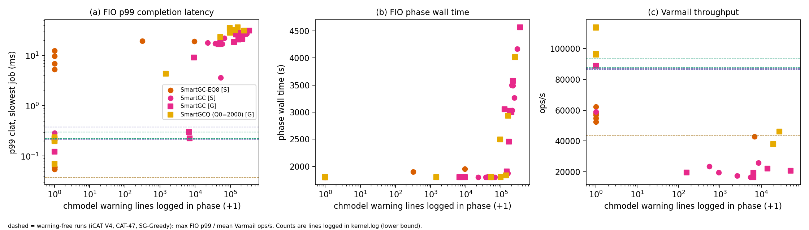
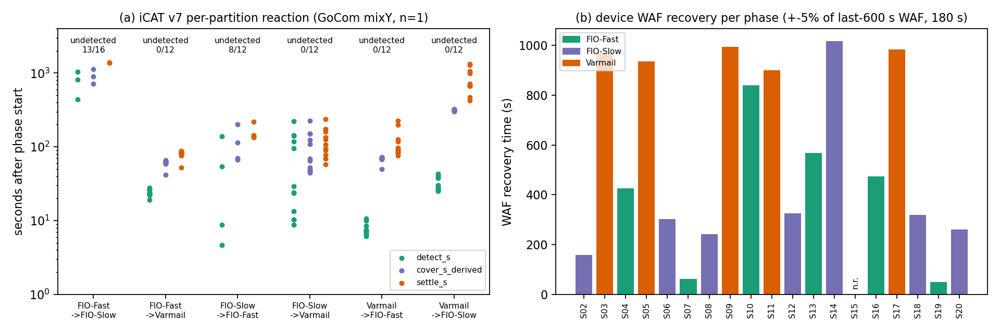

# iCAT 논문 심사 대응: 통합 실험 보고서 (2026-11-23)

- 작성: 고컴(oy-B550M-DS3H, AMD Ryzen 5 3600XT). 브랜치 `report/final-20261123`, 기준 main `a158013fe`(d6f2d3987 이후).
- **새 실험은 실행하지 않았다.** 기존 결과 파일만 읽어 `analysis/final/build_final.py`로 표와 그림을 만들었다. 원본 결과는 수정하지 않았다.
- 표기:
  - **[측정]** 장치 카운터나 계측기에서 바로 읽은 값
  - **[계산]** 측정값이나 코드·sizeof에서 식으로 구한 값
  - **[추정]** 다른 실험의 계수를 빌려 온 값
  - **(확인 필요)** 저장소 안의 증거로 확인할 수 없는 사항
- 두 컴퓨터:
  - **고컴** = oy-B550M-DS3H, Ryzen 5 3600XT
  - **승컴** = oy-System-Product-Name, i7-7700
  - 두 컴퓨터의 결과는 같은 표에 나란히 놓아도 **합산하지 않는다.**
- 공통 장치: NVMeVirt 가상 SSD(memmap 4G+8G, cpus=1,2, FTL 파티션 4개), 커널 7.0.0-31-generic.

---

## 0. 요약

| 심사 질문 | 결론 | 근거 강도 |
|---|---|---|
| Random 선택보다 나은가 | 예. mixFYF 전체 WAF가 2.324에서 2.128로 **0.196 낮다** (95% CI [0.184, 0.208]). FIO-Fast 2 구간에서만 0.366 차이가 난다 | n=3 대 n=3, 고컴 |
| 후보 제거(elimination)가 기여하는가 | 예. 정착이 켜진 상태에서 제거를 끄면 WAF가 **+0.094** 오른다 [+0.070, +0.118] | n=3, 고컴 revB 대 revA |
| 정착(settling)이 기여하는가 | **구분 불가.** 정착을 끄면 평균 +0.087이지만 CI가 [−0.108, +0.282]다. nosettle 3회의 편차가 크다(SD 0.079) | n=3 |
| 탐색 공간 45개 제한이 기여하는가 | **근거 없음.** 60개로 1회 돌린 WAF가 2.128로 V4와 같다 | n=1 |
| SmartGC와 비교 | iCAT V4의 WAF_nand는 3.211, SmartGC-EQ8은 4.492, SmartGC는 11.018이다. host 쓰기 처리량은 8.41 / 6.08 / 4.27 TB다 | n=1, 승컴 |
| SmartGC 큐 적체 경고의 영향 | 경고가 난 FIO 구간은 p99 지연이 **18–27 ms**다. 경고가 없는 정책은 0.2–0.3 ms다. FIO 구간 시간이 최대 **4,568초**까지 늘었다(계획 1,800초) | n=1, 두 컴퓨터 모두 |
| 워크로드 변화에 반응하는가 | Varmail이 낀 전환은 48건 중 48건을 감지했다(중앙값 7–30초). FIO-Fast와 FIO-Slow 사이 전환은 28건 중 7건만 감지했다. WAF 회복 기준은 19개 구간 중 18개에서 충족했다 | iCAT **v7**, n=1, 고컴 |
| 학습 자료구조 크기 | iCAT 학습 상태는 10,848 B [계산, 고컴 revA 빌드]다. SmartGC는 2,343,936 B [계산, 승컴]이다 | 코드와 sizeof |
| 학습 CPU | V4 학습 경로의 누적 시간은 90분 동안 3.88 ms다 [측정, ktime]. 10시간 mixY 기준 V4는 0.97초 [추정]이다. SmartGC 학습 CPU는 미측정이다 | — |



---

## 1. 실험 자산과 원본 경로

### 1.1 고컴 (이번 브랜치로 main에 처음 올라감)

| 캠페인 | 부하 | 정책 (반복 수) | 원본 경로 | 모듈 소스 |
|---|---|---|---|---|
| revA-20261114 | mixFYF: FIO-Fast 1800 s → YCSB-A 1800 s → FIO-Fast 1800 s | Random, V1, V2, V4 각 3회. arm47 1회 | `result/revA-20261114/raw/mixFYF-*` | `revA-src/` (ICAT_VARIANT 분기) |
| revB-20261122 | mixFYF (revA와 같은 seed와 러너) | revB-v4 1회, noelim 3회, nosettle 3회, arm60 1회. 단기 실행 3회는 별도 | `result/revB-20261122/raw/mixFYF-*` | `revB-src/` (`inputs/revB-vs-revA.diff`) |
| sg-20261119 (고컴 SmartGC) | mixY 20 × 1800 s | SmartGC, SmartGCQ(Q0=2000), SG-Greedy, SG-ARM47 각 1회. t4 단기 실행 1회 | `result/gocom-sg-20261119/mixY-*` | cbd444949 `smartgc-src` |
| v7-20261011-icat2 | mixY 20 × 1800 s | iCAT v7 1회 | `result/v7-20261011-icat2/mixY/mixY-onlinev7-rep1` | online-v7 |
| adapt-v7-mixY-20261122 | 위 v7 로그를 다시 분석 (실행 없음) | — | `result/adapt-v7-mixY-20261122/` | — |

> **경로 충돌 주의:** 고컴 로컬의 `result/gc-20261010/mixY-smartgc-rep1`, `mixY-sg-arm47-rep1`은 main에 있는 승컴 결과와 디렉터리 이름이 같다. 그래서 고컴 결과는 `result/gocom-sg-20261119/`에 복사했다. 고컴 원본 위치의 파일은 그대로 두었다.
> 브랜치에는 크기를 줄여 올렸다. `kernel-snapshots/`와 원본 YCSB 텍스트는 제외했다. 5 MB가 넘는 kernel.log는 `.zst`로 압축했다. 전체 원본은 고컴 `/home/oy/iCAT/result/` 아래에 있다.

### 1.2 승컴 (main d6f2d3987 기준)

| 정책 | 부하 | 원본 경로 | commit | 모듈 SHA256 앞 16자리 |
|---|---|---|---|---|
| SmartGC-EQ8 | mixY | `result/gc-20261010/mixY-smartgc-eq8-rep1` | e41aa50ab | cd5432f9abd578cc |
| SmartGC | mixY (재개 실행) | `result/smartgc-20261119/resume/mixY-smartgc-rep1` | 29b5f116b | 33eac9444344b3a5 |
| SmartGC (실패, S13 중단) | mixY | `result/gc-20261010/mixY-smartgc-rep1` | 26cf97801 | 33eac9444344b3a5 |
| CAT-47 (sg-arm47) | mixY | `result/gc-20261010/mixY-sg-arm47-rep1` | 5bd64c679 | 138024d04de8c47b |
| iCAT V4 (onlinev4) | mixY | `result/smartgc-20261119/resume/mixY-onlinev4-rep1` | 01df84464 | db93f822a2e79f1e |

### 1.3 고컴 모듈 SHA256 (전체 값은 각 캠페인의 `modules.sha256`과 run별 `environment.txt`에 있다)

| 모듈 | SHA256 앞 16자리 | 빌드 |
|---|---|---|
| revA-random / v1 / v2 / v4 | 7d88c9a869f18651 / 50ee1c5910562b9f / c74e07148c2dfd5b / 987d62042df380e4 | `make ICAT_VARIANT=…`, revA-src |
| arm47 (revA 참조용) | 9fde0ea49892b1c8 | — |
| revB-v4 / noelim / nosettle / arm60 | 7599cbd68ae7b343 / b1663b470a0a7616 / 928896fbb6a994f6 / b2a19db339e28068 | `make ICAT_VARIANT=4/3/5/6`, revB-src |
| smartgc / smartgcq / sg-greedy / sg-arm47 | da2ebcc0de9d3509 / 3f0b2801dacb19ae / de4e038e3dfb666d / 2b39b3585ba0d737 | cbd444949 |
| online-v7 | eca5160189332643 | — |

revA와 revB는 iCAT HEAD c06a372a5 위의 로컬 소스 사본(`revA-src`, `revB-src`)으로 빌드했다. 두 소스를 이 브랜치에 커밋해서 재현할 수 있게 했다. 고컴 SmartGC 모듈과 승컴 SmartGC 모듈은 commit과 SHA가 다르다. 같은 이름이어도 같은 빌드가 아니다.

### 1.4 버전별 기능 (소스에서 직접 확인)

버전 번호만 보고 기능을 추정하지 않았다. 각 버전의 conv_ftl.h와 conv_ftl.c에서 확인했다.

| 버전 | arm 수 | 후보 제거 | 정착 | 변화 감지 → 재탐색 | 이웃 probe | 판단 구간 |
|---|---|---|---|---|---|---|
| v1 | 60 | X | O | 정착 상태에서만, 12.5 % | O | 64 GC |
| v2 | 60 | X | O | 정착 상태에서만 | O | 192 GC / 768 MiB |
| v3 | 45 | X | O | 정착 상태에서만, 25 % | X | 128 GC / 512 MiB |
| **v4** | 45 | O (15 %) | O | 정착 상태에서만, 25 %, 3구간 | O (8구간마다) | 128 GC / 512 MiB |
| v6 | 45 | O | O | 위에 더해 모든 상태에서 shift-reset (모든 arm 복원) | O | v5에 더해 GC 상한 구간 |
| v7 | 45 | O | O | v6과 같음 | O | 1024 GC, burn-in 256 |

---

## 2. Random 선택 대 iCAT V4 (고컴 revA, mixFYF, 정책당 n=3)

| 지표 | Random | iCAT V4 | 차이 (Random − V4), Welch 95 % CI |
|---|---|---|---|
| WAF 전체 [측정] | 2.324 ± 0.006 | **2.128 ± 0.005** | **+0.196 [0.184, 0.208]** |
| WAF FIO-Fast 1 | 1.940 | 1.900 | +0.040 [0.022, 0.058] |
| WAF YCSB-A | 1.073 | 1.051 | +0.022 [0.011, 0.034] |
| WAF FIO-Fast 2 | 2.809 | 2.443 | **+0.366 [0.340, 0.392]** |
| 후보 선택 수 | 897 | 595 | +302 |
| 현재 최선 arm 외 평가 구간 수 | 886 | 517 | +368 |
| 유효 관측 구간 | 915 | 991 | — |

- Random은 V4와 같은 45개 후보, 판단 구간, burn-in을 쓴다. 매 구간마다 xorshift64*로 균등 추첨한다.
- 차이는 대부분 두 번째 FIO-Fast 구간에서 생긴다. 쓰기가 누적된 구간이다.
- 원본 표: `result/revA-20261114/results/random_vs_icat*.csv`. 통합 표: `tables/random_vs_v4.csv`.

---

## 3. Ablation: revA와 revB를 나눠서 적는다 (고컴, mixFYF)

### 3.1 revA (2026-11-14, 사전 등록, 정책당 n=3)

| 변형 | 정의 | WAF 전체 | 95 % CI |
|---|---|---|---|
| V4 | 전체 | **2.128** | [2.116, 2.141] |
| V1 (revA 정의) | drift 감지와 재탐색만 제거 | 2.207 | [2.077, 2.337] |
| V2 (revA 정의) | 후보 제거와 정착 제거. drift도 결과적으로 동작하지 않는다 | 2.264 | [2.241, 2.287] |
| Random | 균등 무작위 | 2.324 | [2.311, 2.338] |

※ revA의 V1과 V2는 논문의 iCAT-v1이나 iCAT-v2와 **다르다**(revA 사전 등록 참조).

### 3.2 revB (2026-11-22 ~ 23, 사전 등록, 2×2 보강)

| 변형 | 후보 제거 | 정착 (drift와 probe 포함) | arm 수 | n | WAF 전체 | 범위 |
|---|---|---|---|---|---|---|
| revB-v4 (브리지) | O | O | 45 | 1 | 2.152 | — |
| noelim | X | O | 45 | 3 | 2.223 | 2.210 – 2.231 |
| nosettle | O | X | 45 | 3 | 2.215 | **2.143 – 2.300** |
| arm60 | O | O | 60 | 1 | 2.128 | — |

**브리지 판정은 불합격이다.**
- revB-v4는 2.152로, revA-v4(2.128 ± 0.005)보다 1.11 % 높다. 표준편차로는 4.8 SD다. 사전 기준(±1 % 그리고 ±3 SD)을 넘는다.
- 차이는 FIO-Fast 2 구간에서만 생긴다(2.490 대 2.431–2.456). 끝에서 파티션 3이 arm 16에 머물렀고, revA에서는 46–47이었다.
- 사전 등록 규칙에 따라 revA 재사용을 "보류"로 기록했다. 주 분석은 revA-v4(n=3)를 쓰고, revB-v4를 합친 n=4는 민감도 분석으로 함께 보인다.
- 따라서 **V4의 반복 간 편차는 revA 3회에서 본 것보다 클 수 있다.**

### 3.3 2×2 효과 (`tables/ablation_2x2.csv`, Welch 95 % CI, 단위는 WAF)

| 대비 | 차이 | 95 % CI | 판정 |
|---|---|---|---|
| 제거 효과, 정착 켬 (noelim − V4) | **+0.094** | [+0.070, +0.118] | 구분됨 |
| 위와 같음, V4 n=4 | +0.088 | [+0.065, +0.112] | 구분됨 |
| 제거 효과, 정착 끔 (V2 − nosettle) | +0.049 | [−0.144, +0.241] | 구분 불가 |
| 정착 효과, 제거 켬 (nosettle − V4) | +0.087 | [−0.108, +0.282] | 구분 불가 |
| 정착 효과, 제거 끔 (V2 − noelim) | +0.041 | [+0.018, +0.065] | 구분됨 |
| 둘 다 제거 (V2 − V4) | +0.135 | [+0.117, +0.154] | 구분됨 |
| 상호작용 | +0.045 | 약 ±2 SE: [−0.048, +0.138] | 구분 불가 |

해석:
- 후보 제거는 정착이 켜진 실제 V4 구성에서 WAF를 약 4 % 낮춘다.
- 정착은 제거가 꺼진 상태에서는 효과가 있다. 제거가 켜진 상태에서는 nosettle의 편차 때문에 판정할 수 없다. nosettle의 FIO-Fast 2 구간 WAF는 2.48–2.80이었다.
- nosettle은 정착에 딸린 drift 감지와 probe도 함께 꺼진다. 그래서 "정착만의 순수 효과"라고 주장하지 않는다.

---

## 4. mixY: SmartGC, SmartGC-EQ8, CAT-47, iCAT 비교 (`tables/mixY_compare.csv`)



### 4.1 승컴 (같은 컴퓨터, 같은 seed, 정책당 n=1)

| | SmartGC-EQ8 | SmartGC | CAT-47 | **iCAT V4** |
|---|---|---|---|---|
| WAF = 1 + GC/host [측정] | 4.498 | 11.072 | 3.233 | **3.211** |
| WAF_nand = NAND 쓰기/host [계산, 카운터] | 4.492 | 11.018 | 3.233 | **3.211** |
| S01–S20 host 쓰기 [측정] | 6.08 TB | 4.27 TB | 7.93 TB | **8.41 TB** |
| S01–S20 실제 경과 시간 [측정] | 10.08 h | **12.72 h** | 10.01 h | 10.01 h |
| GC 횟수 | 104.1 M | 179.7 M | 97.8 M | 103.1 M |

- iCAT V4의 WAF_nand는 SmartGC-EQ8보다 **28.5 % 낮다**.
- CAT-47과의 차이는 0.7 %다. n=1이므로 우열을 판정하지 않는다.
- 승컴의 대표 SmartGC는 EQ8이다. 결과를 보기 전(11-19)에 정한 규칙을 따랐다.

### 4.2 고컴 (참고용 재현, 정책당 n=1, 승컴과 합산하지 않음)

| | SmartGC | SmartGCQ (Q0=2000) | SG-Greedy | SG-ARM47 (= CAT-47) | iCAT v7 |
|---|---|---|---|---|---|
| WAF_nand | 10.171 | 4.585 | 6.181 | 3.298 | 3.319 |
| host 쓰기 (TB) | 4.64 | 8.50 | 5.36 | 8.32 | 8.48 |
| 경과 시간 (h) | 12.50 | 11.14 | 10.01 | 10.01 | 10.01 |

- **같은 SmartGC 알고리즘을 두 컴퓨터에서 돌렸다.**
  - SmartGC의 WAF_nand는 승컴 11.02, 고컴 10.17이다.
  - CAT-47의 WAF는 승컴 3.233, 고컴 3.298이다.
  - 경향은 재현됐다. 다만 빌드(commit, SHA)와 컴퓨터가 다르다.
- 고컴에는 iCAT V4의 mixY 실행이 없다. v7만 있다.

### 4.3 WAF, 처리량, 자료구조 크기

| 항목 | SmartGC-EQ8 | SmartGC | CAT-47 | iCAT V4 | 종류 |
|---|---|---|---|---|---|
| WAF_nand | 4.492 | 11.018 | 3.233 | 3.211 | 계산 (카운터) |
| FIO-Fast 평균 쓰기 속도 (목표 163.8 MB/s) | 160.8 MB/s | **98.4 MB/s** (최저 70.8) | 163.8 | 163.8 | 측정 (fio) |
| FIO p99 완료 지연, 구간 최댓값 | 19.5 ms | 27.9 ms | 0.38 ms | 0.31 ms | 측정 (fio) |
| Varmail 평균 처리량 | 54,567 ops/s | 27,009 | 86,413 | **93,414** | 측정 (filebench) |
| 학습·정책 상태 크기 | 2,343,936 B | 2,343,936 B | 0 | 10,112 B (승컴 인용) / 10,848 B (고컴 revA 빌드) | 계산 (코드, sizeof) |

- FIO는 IOPS 상한이 있고, 쓰는 양이 고정이다(`--rate_iops`, io_size). 장치가 못 따라가면 처리량이 떨어지는 대신 **구간이 길어진다**. 그래서 처리량 비교는 "같은 시간에 쓴 양"보다 "구간별 MB/s와 구간 시간"으로 보는 것이 정확하다.
- 자료구조 크기의 iCAT 값이 두 개다.
  - 승컴 보고서 값 10,112 B는 online-v4 tuner 2,656 B에서 고정 CAT도 쓰는 128 B를 뺀 학습 전용 크기(× 4)다. 출처는 `origin/resource-overhead-20261114`다.
  - 고컴 revA 빌드는 계측 카운터 때문에 2,712 B × 4 = 10,848 B다.

---

## 5. CPU: 측정값과 추정값 구분 (`tables/cpu_metrics.csv`)

| 대상 | 값 | 종류 | 설명 |
|---|---|---|---|
| iCAT V4 학습 경로 누적 시간, mixFYF 90분 | **3.88 ± 0.11 ms** (n=3) | 측정 | 학습 결정 경로(observe + set_arm)를 `ktime_get_ns()`로 감싸 합산했다. 프로세스 CPU 사용량이 **아니다** |
| 같은 측정: Random / V1 / V2 | 2.77 / 3.68 / 9.04 ms | 측정 | — |
| 같은 측정: noelim / nosettle / arm60 / revB-v4 | 6.99 / 3.33 / 3.68 / 4.12 ms | 측정 | revB |
| 학습 시간 / 경과 시간 | V4 0.0001 % 미만 | 계산 | — |
| nvmev dispatcher 스레드 사용률, mixY 10 h | 4개 정책 모두 99.9 % | 측정 (승컴 schedstat) | busy-poll 구조라 정책을 구분할 수 없다 |
| iCAT V4 학습 CPU, mixY 10 h | 0.97 s | **추정** | GC 103,056,001회 × 9.4 ns. 9.4 ns는 계측 빌드에서 잰 GC당 시간의 V4 − CAT-47 차분이다 (FIO-Fast 30분, `origin/resource-overhead-20261114`) |
| SmartGC 학습 CPU | 미측정 | — | smartgc-src에 시간 측정 장치가 없다. step 수만 있다 (EQ8 47,796회, SmartGC 22,456,563회) |

- 시스템 전체 CPU 사용량은 측정하지 않았다. 위 값으로 전체 CPU를 말하지 않는다.

## 6. 메모리: VmallocUsed와 sizeof는 별도 지표다 (`tables/memory_metrics.csv`)

| 지표 | 무엇을 재나 | SmartGC | CAT-47 | iCAT V4 | 종류 |
|---|---|---|---|---|---|
| VmallocUsed 증가량 (실행 중 평균 − 로드 전) | 커널 vmalloc 전체. 에뮬레이터 자체 메모리 약 35 MB가 포함된다 | 37,606 kB | 35,595 kB | 34,741 kB | 측정, 승컴 n=1 |
| 모듈 coresize | 모듈 코드와 정적 데이터 | 102,400 B | 94,208 B | 106,496 B | 측정 (/proc/modules) |
| 학습·정책 상태 | 학습 자료구조만 | 2,343,936 B | 0 | 10,112 / 10,848 B | 계산 (sizeof) |

- VmallocUsed의 정책 간 차이(+2,010 kB, −854 kB)는 sizeof 계산과 크기 규모가 비슷하다. 하지만 n=1이라 잡음 크기를 모른다. **두 지표를 서로 증명하는 데 쓰지 않는다.**
- 커널 스레드라 RSS는 없다.
- 고컴 revA에서는 vmalloc 최댓값만 일부 run에서 샘플링했다 (`revA-20261114/results/resource/memory_measurements.csv`).

---

## 7. SmartGC 큐 적체 경고가 처리량과 지연에 준 영향 (`tables/chmodel_warning_impact.csv`, `mixY_phase_perf.csv`)



**경고의 의미** (channel_model.c:74)
- 요청 시각이 채널 모델 창(96K × 4 µs = 0.39 s)보다 멀리 밀리면 "Need to increase array size"가 찍힌다. 곧 장치 대기열이 0.39 s 넘게 밀렸다는 뜻이다.
- 이때 그 요청의 채널 지연은 계산에서 빠진다.

**발생량** [측정]
- 아래 수는 kernel.log에 남은 줄 수다. 링 버퍼가 넘쳐 일부가 빠졌을 수 있으므로 **하한**이다. 실패한 승컴 실행에서는 syslog에 7,089만 줄이 쌓였다.

| 컴퓨터 | 정책 | 로그에 남은 경고 줄 | 경고가 난 구간 수 | 경고 구간 FIO p99 평균 | 경고 없는 구간 FIO p99 평균 | FIO 구간 최장 시간 | Varmail 평균 |
|---|---|---|---|---|---|---|---|
| 승컴 | SmartGC | 1,757,750 | 17 / 20 | 21.6 ms | 0.25 ms | 4,167 s | 27,009 ops/s |
| 승컴 | SmartGC-EQ8 | 16,563 | 3 | 19.4 ms | 2.90 ms | 1,951 s | 54,567 |
| 승컴 | CAT-47 / iCAT V4 | 0 / 0 | 0 | — | 0.28 / 0.24 ms | 1,801 s | 86,413 / 93,414 |
| 고컴 | SmartGC | 1,583,380 | 17 | 17.9 ms | 0.17 ms | 4,568 s | 31,179 |
| 고컴 | SmartGCQ | 842,597 | 9 | 27.2 ms | 0.19 ms | 4,015 s | 84,055 |
| 고컴 | SG-Greedy / SG-ARM47 / iCAT v7 | 0 | 0 | — | 0.03 / 0.18 / 0.18 ms | 1,801 s | 43,753 / 87,184 / 87,859 |

**해석**
1. 경고는 SmartGC 계열에서만, WAF가 높은 구간에만 난다. SmartGC의 FIO-Fast 구간 평균 WAF는 11.4이고 V4는 4.6이다. 이런 구간에서는 FIO p99가 경고 없는 정책보다 **약 100배** 크다(약 20 ms 대 0.2 ms). FIO-Fast 쓰기 속도는 평균 목표의 60–63 %, 가장 느린 구간은 39–43 %로 떨어진다. 그래서 구간이 1,800 s에서 최대 4,568 s로 늘었다.
2. 경고가 지연을 일으킨 것이 아니다. 경고는 GC 부하로 장치 대기열이 밀린 결과다. 경고 구간에서는 채널 지연이 빠지므로, **보고된 SmartGC 지연과 처리량은 실제보다 유리하게(작게) 나왔을 가능성이 크다.** 같은 방향으로 iCAT의 우위는 과소평가됐을 수 있다.
3. WAF는 FTL 페이지 카운터에서 나오므로 경고의 영향을 받지 않는다.
4. 처리량 수치 해석: SmartGC의 host 쓰기 총량(4.27 TB)이 작은 이유는 두 가지다. Varmail 구간은 1,800 s 고정이라 ops/s가 그대로 총량을 줄인다. FIO 구간은 쓰는 양이 고정이라 총량 대신 시간이 늘어난다.
5. **(확인 필요)** SG-Greedy의 FIO p99는 0.03 ms다. 다른 경고 없는 정책(0.16–0.38 ms)보다 비정상적으로 낮다. 원인은 확인하지 않았다.

---

## 8. 워크로드 변화 감지와 WAF 회복

### 8.1 iCAT v7, mixY (고컴, n=1, `result/adapt-v7-mixY-20261122/`)

- **정의:** 로그에 있는 시각만 쓰고 보간하지 않았다.
  - 감지 = 구간 시작 표식 이후 첫 `WATGC_V2 reset`
  - 재탐색 완료 = reset 뒤 처음으로 active arm 수가 줄어든 sample [계산]
  - 정착 = reset 뒤 첫 `settled`
  - 회복 = 최근 300 s WAF가 그 구간 마지막 600 s WAF의 ±5 % 안에 180 s 연속 머문 첫 시점. 구간 끝 600 s 전까지만 찾는다.

| 전환 (파티션 × 횟수) | 감지 | 감지 중앙값 | 재탐색 완료 중앙값 | 정착 중앙값 |
|---|---|---|---|---|
| Varmail → FIO-Fast (12) | 12 | 7 s | 70 s | 94 s |
| FIO-Fast → Varmail (12) | 12 | 23 s | 63 s | 82 s |
| FIO-Slow → Varmail (12) | 12 | 27 s | 67 s | 101 s |
| Varmail → FIO-Slow (12) | 12 | 30 s | 314 s | 680 s |
| FIO-Slow → FIO-Fast (12) | **4** | 31 s | 92 s | 141 s |
| FIO-Fast → FIO-Slow (16) | **3** | 814 s | 894 s | 1,383 s |

- reset은 모두 109회이고, 그중 80회가 v6 shift-reset이다.
- Varmail → FIO-Slow 구간에서는 파티션당 약 3.3회 reset이 반복됐다.
- WAF 회복은 **19개 구간 중 18개**에서 기준을 충족했다(S15 미회복).
  - FIO 구간: 50–1,016 s
  - Varmail 구간: 900–993 s. Varmail은 구간 안에서도 부하 특성이 바뀌기 때문에 회복 기준점 자체가 늦게 정해진다.
- 

### 8.2 iCAT V4, mixFYF (고컴 revA, n=3)

- YCSB-A → FIO-Fast 전환에서 V4의 자기 기준 회복 시간은 636 / 996 / 786 s였다.
- Random은 305–306 s였다. Random의 WAF는 처음부터 높은 값으로 평평해서 금방 "회복"으로 판정된다. 그래서 회복 시간만으로 우열을 비교하면 안 된다.
- CAT-47의 같은 구간 WAF × 1.05를 기준으로 하면 학습기 모두 미회복이다 (`revA-20261114/results/waf_recovery.csv`).
- V4는 YCSB-A → FIO-Fast 전환 뒤 3회 모두 drift reset을 했다. 첫 reset은 전환 후 61.7–65.5 s였다. FIO-Fast → YCSB-A 전환에서는 첫 reset이 850–1,868 s로 늦었다 (`workload_transition.csv`).

---

## 9. 탐색 비용, 후보 수, 판단 구간의 근거 (`tables/exploration_cost.csv`)

| 변형 (mixFYF, 4개 파티션 합) | 유효 판단 구간 | 후보 선택 | 최선 외 평가 | 제거 | 최선 arm 변경 | drift reset | 탐색 비율 | 학습 시간 |
|---|---|---|---|---|---|---|---|---|
| Random | 915 | 897 | 886 | 0 | 47 | 0 | 0.97 | 2.77 ms |
| V2 | 924 | 868 | 794 | 0 | 40 | 0 | 0.86 | 9.04 ms |
| noelim | 941 | 793 | 716 | 0 | 77 | 4 | 0.76 | 6.99 ms |
| **V4** | 991 | 595 | 517 | 197 | 70 | 4 | **0.52** | 3.88 ms |
| arm60 (n=1) | 990 | 602 | 534 | 254 | 56 | 4 | 0.54 | 3.68 ms |
| nosettle | 1,029 | 439 | 403 | 176 | 42 | 0 | 0.39 | 3.33 ms |

- 후보 제거는 V4의 탐색 비율을 0.76에서 0.52로 낮춘다. 이것이 0.094 WAF 개선과 같은 방향이다.
- **코드 근거** (`revA-src/conv_ftl.h:28–59`)
  - 후보는 k 4개 × scale 5개 × ratio 3개 = 60 arm이다. `ARM_LO=15`로 k=2인 15개를 뺀다.
  - 판단 구간은 파티션당 GC 128회 그리고 host 512 MiB다. 상한은 GC 8,192회 또는 300 s다. burn-in은 GC 32회 / 128 MiB다.
  - 후보 제거는 평균이 최선보다 15 % 넘게 나쁜 arm이다.
  - 정착은 안정 구간 12개와 최선 확인 3회가 조건이다. probe는 8구간마다, drift는 25 %가 3구간 이어질 때다.
- **근거가 약한 부분**
  - 45개 제한에 대한 근거는 코드 주석의 "k=2가 9번의 sweep에서 모두 최하위"뿐이다. 승컴 정리에 따르면 그 기록은 `EXPERIMENT_LOG.md:7719`에 있다. 같은 기간 승컴의 k=2 복원 실험(`result/mix-20260911/t4-onlinev3k2-rep1-x18`, FIO-Fast 3시간, n=1)에서는 WAF가 1.848에서 1.905로 3.1 % 나빠졌다. 온라인 학습에서 제한 효과는 n=1(arm60 2.128 대 V4 2.128)로 확인되지 않았다.
  - 판단 구간 길이(128 GC / 512 MiB)만 바꾼 실험은 없다. 구간이 다른 v1(64)과 v2(192)는 다른 기능도 함께 다르다. 그래서 **구간 길이 단독 효과는 미검증**이다.

---

## 10. 심사 의견별 대응 근거표

| 심사 질문 | 근거 코드 | 근거 결과 | 추가 실험 필요 | 권장 조치 |
|---|---|---|---|---|
| Random 선택과 비교했나 | revA-src ICAT_VARIANT=9 (Random) | §2. Random − V4 = +0.196 WAF, n=3 | 아니요 | 그림 1(a)와 §2 표를 본문에 넣는다 |
| 각 구성 요소의 기여 | revA, revB 분기 (`revB-vs-revA.diff`) | §3. 제거 효과 유의, 정착·45개 제한은 구분 불가 | 정착은 n 추가가 필요하다 (nosettle 편차가 큼) | "제거는 기여, 정착은 이 부하에서 판정 불가"로 쓴다. arm60은 n=1로 명시한다 |
| 재현성 (반복 편차) | — | 브리지 불합격 (+1.1 %, 4.8 SD) | revB-v4 2회 추가 시 판정 가능 | 한계 절에 V4 편차가 과소추정됐을 수 있다고 적는다 |
| 최신 학습 기반 GC(SmartGC)와 비교 | smartgc-src (승컴 e41aa50ab, 29b5f116b) | §4. WAF_nand 3.21 대 4.49 / 11.02, n=1 | 반복이 있으면 좋다 | n=1 주의와 함께 §4.1 표를 넣는다. EQ8 선택 규칙도 명시한다 |
| 처리량과 지연 비용 | fio json, filebench | §4.3, §7 | 아니요 | "SmartGC 지연은 경고 때문에 과소 계산됐을 수 있다"를 명시한다 |
| 계산 오버헤드 | ktime 계측 (revA) | §5. V4 3.88 ms/90분 [측정], 0.97 s/10 h [추정] | 같은 부하의 SmartGC 학습 시간 측정이 필요하다 | 측정값과 추정값을 구분해 표기한다 |
| 메모리 오버헤드 | sizeof, /proc/meminfo | §6 | 아니요 | sizeof를 주 지표로, VmallocUsed를 보조(n=1)로 쓴다 |
| 워크로드 변화 적응 | v6/v7 shift-reset, V4 drift | §8. v7 mixY n=1, V4 mixFYF n=3 | V4의 mixY 변화 분석은 승컴 로그로 가능하다 (미수행) | v7 결과임을 명시한다. V4와 섞지 않는다 |
| 탐색 비용과 판단 구간 근거 | conv_ftl.h:28–59 | §9 | 판단 구간 길이 단독 변경 실험 | 구간 근거는 "설계 선택"으로 쓰고 효과를 주장하지 않는다 |

## 11. 아직 입증하지 못한 주장

1. **정착(settling)이 WAF를 낮춘다.** 제거가 켜진 상태에서는 CI가 0을 포함한다 (§3.3).
2. **탐색 공간을 45개로 제한하는 것이 이득이다.** arm60이 n=1이고 V4와 같다. sweep 근거 데이터의 위치도 확인이 필요하다.
3. **판단 구간 128 GC / 512 MiB가 적절하다.** 구간 길이만 바꾼 실험이 없다.
4. **iCAT V4가 CAT-47보다 낫다 (mixY).** 0.7 % 차이이고 n=1이다.
5. **iCAT V4가 SmartGC보다 낫다는 통계적 유의성.** 모든 SmartGC 비교는 n=1이다. 차이 크기(28.5 % 이상)로만 말할 수 있다.
6. **V4의 워크로드 변화 반응 (mixY).** §8.1은 v7 결과다. V4 mixY의 감지와 회복은 분석하지 않았다.
7. **SmartGC 학습 CPU, iCAT V4의 mixY 학습 CPU 측정값.** 전자는 미측정이고 후자는 추정값이다(9.4 ns/GC 차분 계수, FIO-Fast 30분에서 잼).
8. **(해결) iCAT 학습 상태 10,112 B.** 학습 전용 정의이고 gdb sizeof와 일치한다. revA 10,848 B는 계측 카운터를 포함한 값이다 (`report/revision-20261123-gocom/resource_overhead_final.md`).
9. **FIO-Fast와 FIO-Slow 사이 전환 감지.** v7은 28건 중 7건만 감지했다. "모든 변화를 감지한다"고 쓰면 안 된다.
10. **SmartGC 지연과 처리량 수치의 정확성.** 경고 구간에서는 채널 지연이 빠지므로 실제보다 좋게 나왔을 수 있다.
11. **mixY의 CAT-47 기준값.** 같은 arm 47인데 10월 fixed47은 2.864, 11월 sg-arm47은 3.233(승컴)과 3.298(고컴)이다. 승컴이 원인 점검을 사전 등록했다(main a158013fe). 결과가 나오기 전까지는 §4의 CAT-47 비교를 "11월 빌드 기준"으로 한정한다.

## 12. 원본 데이터와 재현 방법

```bash
git switch report/final-20261123
python3 analysis/final/build_final.py         # 약 10초. 결과: result/final-20261123/{tables,figures,manifest.json}
# 의존성: python3, matplotlib, scipy(Welch df의 t 분위수와 p값. 없으면 근사 사용), zstd
# 원본 분석 스크립트: result/revA-20261114/analyze.py, result/adapt-v7-mixY-20261122/analyze_adapt.py,
#                     analysis/smartgc/compare.py (승컴)
```

- `tables/fyf_runs.csv`: run별 유효성(exit, FIO IO 수, YCSB 오류, 커널 오류), WAF, 학습 카운터, 원본 경로
- 브랜치의 v7 kernel.log는 `.zst`로 압축되어 있다. `analyze_adapt.py`를 다시 돌리려면 먼저 `zstd -d`로 풀어야 한다.
- `manifest.json`: run별 모듈 SHA256, WAF, 생성 시점의 git HEAD
- 실험 재실행 명령
  - revA와 revB: 각 캠페인의 `run-one.sh <policy> <rep>`를 쓴다. seed는 FIO 20260910/20261010/20261110 + rep, icat 2026111400 + rep다.
  - 고컴 SmartGC: `result/gocom-sg-20261119/campaign/mix-gc-20261010.local.sh`를 쓴다. upstream과의 차이는 `local-vs-upstream.diff`에 있다(장치 잠금과 CSL_Virt 검사).
- 실험일지: `EXPERIMENT_LOG.md`. 고컴 로컬 일지 776행을 이번 브랜치에서 원문 그대로 병합했다.
