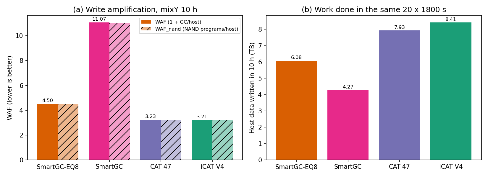
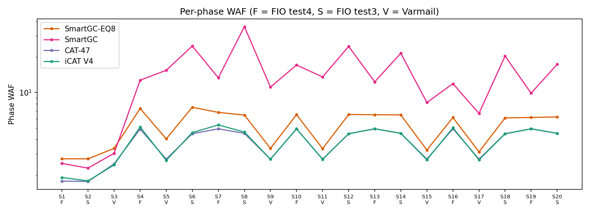
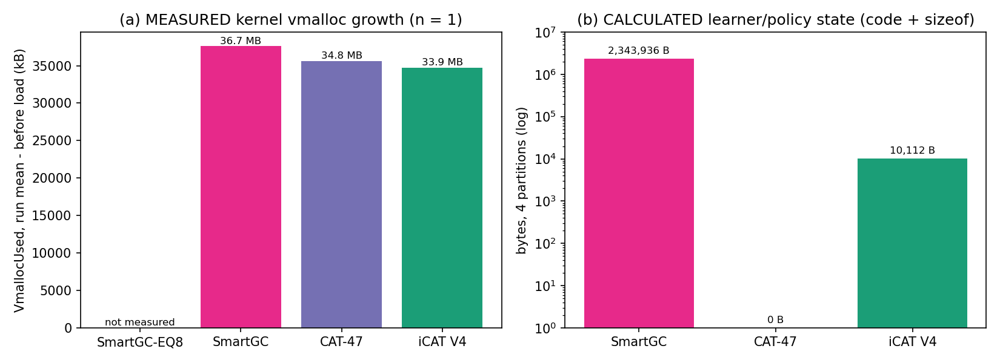

# SmartGC vs CAT-47 vs iCAT V4: mixY 10시간 비교 (2026-11-23)

- **부하:** mixY, 20단계 × 1,800초 (F S V F V S F S V F V S F S V F V S F S). F = FIO test4, S = FIO test3, V = Varmail.
- **장치:** 8 GiB 에뮬레이터, 파티션 4개. 정책마다 rep 1 한 번씩 돌렸고, 시드는 모든 정책이 같다.
- **분석:** `analysis/smartgc/compare.py`가 기존 결과 파일만 읽어서 계산한다. 새 실험은 하지 않았다.
- **출력 파일:** `compare.csv`, `phase_waf.csv`, `memory_calculated.csv`, `fig1–3`.

## 1. 결론

| | SmartGC-EQ8 | SmartGC | CAT-47 | **iCAT V4** |
|---|---|---|---|---|
| WAF (1 + GC/host) | 4.498 | 11.072 | 3.233 | **3.211** |
| WAF_nand (NAND 쓰기/host) | 4.492 | 11.018 | 3.233ᵃ | **3.211**ᵃ |
| 10시간 동안 처리한 host 쓰기 | 6.08 TB | 4.27 TB | 7.93 TB | **8.41 TB** |
| GC 횟수 | 104,132,099 | 179,652,503 | 97,804,072 | 103,056,001 |
| 학습 step 수 | 47,796 | 22,456,563 | — | 미측정 |

ᵃ CAT-47과 iCAT 빌드에는 GC 버퍼가 없다. 그래서 host 쓰기와 GC 쓰기가 모두 그대로 NAND 쓰기가 되고, WAF_nand = WAF다.

- **SmartGC 대표는 SmartGC-EQ8로 정했다.** 결과를 보기 전(11-19)에 EXPERIMENT_LOG에 미리 적어 둔 규칙을 따랐다. 규칙은 "논문에 충실한 두 해석 중 WAF_nand가 낮은 쪽을 쓴다"이고, 4.492가 11.018보다 낮다.
- **iCAT V4 대 SmartGC-EQ8:** WAF_nand가 **28.5 %** 낮다 (3.211 대 4.492). 같은 10시간 동안 host 쓰기는 **38.5 %** 더 처리했다 (8.41 대 6.08 TB).
- **iCAT V4 대 CAT-47:** WAF는 0.7 % 낮고, host 쓰기는 6.1 % 더 처리했다. 이 차이는 반복 1회로 생긴 변동 범위 안일 수 있다.

## 2. 요청 표 (브리프 §10)

| 정책 | 빌드 (sha256 앞 12자리) | 로드 (coresize) | GC 실행 | WAF | CPU (dispatcher / io_worker) | 학습 메모리 (계산값) |
|---|---|---|---|---|---|---|
| SmartGC-EQ8 | cd5432f9abd5 | ✅ 102,400 B | ✅ 104.1 M회 | 4.498 | 99.9 % / 100 % | 2,343,936 B |
| SmartGC | 33eac9444344 | ✅ 102,400 B | ✅ 179.7 M회 | 11.072 | 99.9 % / 100 % | 2,343,936 B |
| CAT-47 (sg-arm47) | 138024d04de8 | ✅ 94,208 B | ✅ 97.8 M회 | 3.233 | 99.9 % / 100 % | 0 B |
| iCAT V4 (onlinev4) | db93f822a2e7 | ✅ 106,496 B | ✅ 103.1 M회 | 3.211 | 99.9 % / 100 % | 10,112 B |
| smartgcq | 8af1f1c4… (빌드만) | 미측정 | 미측정 | 미측정 | 미측정 | 미측정 |
| smartgcq-eq8 | fa6ceffb… (빌드만) | 미측정 (11-22 시간 부족으로 사용자가 제외) | 미측정 | 미측정 | 미측정 | 미측정 |
| sg-greedy | cb729270… (빌드만) | 미측정 | 미측정 | 미측정 | 미측정 | 미측정 |

## 3. CPU

- **CPU 측정 방법:** nvmev 커널 스레드의 schedstat 실행 시간을 30초마다 기록했다. 첫 샘플과 마지막 샘플의 차이를 그 사이 경과 시간으로 나눈 값이 위 표의 %다.
- **CPU 시간으로는 정책을 구분할 수 없다.** 두 스레드 모두 일이 없어도 쉬지 않고 대기하며 도는 구조(busy-poll)라서, 어떤 정책이든 CPU 하나를 약 100 % 쓴다.
- **SmartGC 학습 CPU는 미측정이다.** smartgc-src 코드에 함수 단위 시간 측정 장치가 없다. 학습이 얼마나 일했는지는 step 수로만 볼 수 있다 (EQ8 47,796회, SmartGC 22,456,563회).
- **iCAT V4 학습 CPU는 추정값 0.97초다 (측정값 아님).** 계산식은 GC 103,056,001회 × GC 1회당 9.4 ns다.
  - 9.4 ns는 resource-v124-20261114 실험에서 계측 빌드로 잰 값이다. 그 실험의 부하는 FIO-Fast 30분이라 이번 부하와 다르다.
  - 10시간 dispatcher CPU 36,045초와 비교하면 0.003 %에 해당한다.

## 4. 메모리: 측정값과 계산값을 나눠서 적는다

**(a) 측정값: VmallocUsed 증가량.** 모듈을 올리기 전 샘플 1개와 실행 중 샘플들의 평균을 비교했다. 정책마다 1회씩만 돌렸다 (n = 1).

| | SmartGC-EQ8 | SmartGC | CAT-47 | iCAT V4 |
|---|---|---|---|---|
| 실행 중 평균 − 로드 전 | 미측정ᵇ | 37,606 kB | 35,595 kB | 34,741 kB |
| CAT-47과의 차이 | — | +2,010 kB | 0 | −854 kB |

ᵇ eq8은 이미 실행 중일 때 샘플링을 붙였기 때문에 로드 전 샘플이 없다.

- **이 값의 대부분은 SSD 에뮬레이터 자체가 쓰는 메모리다.** 약 35 MB가 정책과 상관없이 공통으로 잡혀 있다.
- **정책끼리의 차이는 계산값과 크기가 비슷하다. 다만 n = 1이라 잡음 크기를 모르고, 증명은 아니다.**
  - SmartGC − CAT-47 = +2,010 kB이고, SmartGC 배열 계산값은 2,289 kB다.
  - iCAT V4 − CAT-47 = −854 kB다.
    - 계산으로 보면 line 구조체가 iCAT 빌드에서는 48 B, smartgc-src 빌드에서는 72 B다. 24 B × 8,192 × 4 = 768 kB만큼 iCAT이 작다.
    - 여기에 iCAT 학습 상태 +10 kB가 더해진다.
- **Slab 증가량(75–111 MB)은 정책 차이로 볼 수 없다.** 다른 시스템 활동과 섞여서 정책 순서와 맞지 않는다. 그래서 결론에는 쓰지 않았다.
- **RSS는 없다.** 커널 스레드에는 사용자 주소 공간(mm)이 없어서 RSS가 존재하지 않는다.

**(b) 계산값: 코드와 sizeof로 계산했다 (측정이 아니다). 파티션 4개를 합한 값이다.**

| | 바이트 | 근거 |
|---|---|---|
| SmartGC / SmartGC-EQ8 | 2,343,936 | Q-table 640,000 + 후보 목록, 정렬, 드레인, GC 버퍼 비트맵 1,703,936 (`smartgc_memory_sizes.csv`) |
| CAT-47 | 0 | 학습 상태 없음 |
| iCAT V4 | 10,112 | 학습 상태 sizeof (resource-v124-20261114) |

- SmartGC는 iCAT V4보다 학습 관련 상태가 약 **232배** 크다.
- SmartGC의 Q-table은 100×100 상태 × 행동 2개 크기로 고정이다.
- 나머지 배열은 블록 수나 페이지 수에 비례한다. 그래서 SSD 용량이 커지면 같이 커진다.

## 5. 한계와 사건

- **반복 1회:** 정책마다 1회씩만 돌렸다. CAT-47과 iCAT V4의 0.7 % 차이는 유의한 차이라고 말할 수 없다.
- **smartgc 첫 시도 실패 (11-20):**
  - 채널 모델 경고 "Need to increase array size"가 7,089만 줄 찍히면서 시스템 로그가 루트 디스크를 가득 채웠고, S13 단계에서 실패했다. 실패한 디렉터리는 `result/gc-20261010/mixY-smartgc-rep1`에 그대로 보존했다.
  - 11-22에 rsyslog 필터를 추가하고 `resume/`에 다시 돌렸다. 모듈과 코드는 바꾸지 않았다.
- **채널 모델 경고가 뜻하는 것:** 장치 대기열이 0.39초 넘게 밀렸다는 뜻이다. 이 경고가 뜨면 그 요청에서는 채널 지연이 빠진다.
  - 그래서 SmartGC의 처리량은 실제보다 높게 나왔을 수 있다. 그렇다면 SmartGC 쪽에 유리한 오차다.
  - WAF 페이지 카운터는 이 경고의 영향을 받지 않는다.
- **SmartGC의 경과 시간이 12.7시간이다.** 다른 정책은 약 10시간이다. 측정 단계는 1,800초 × 20으로 같고, 시간이 더 걸린 것은 준비 단계(파일 채우기)가 느렸기 때문으로 보인다.
- **CAT-47 표기:** CAT-47은 sweep 60개 설정 중 2등이다. 최적값(oracle)이 아니다.
